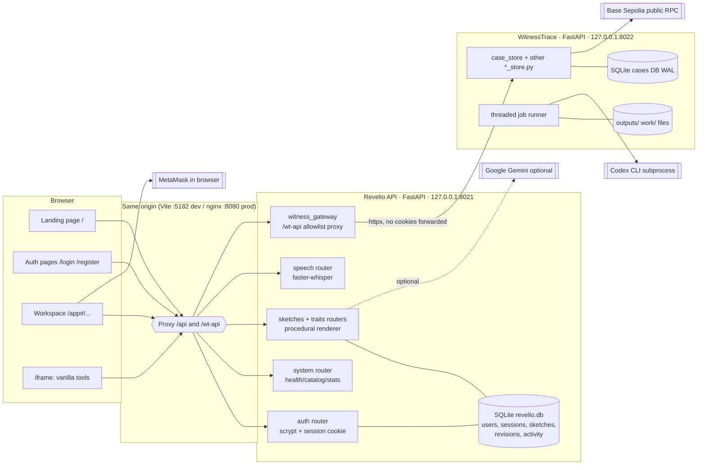
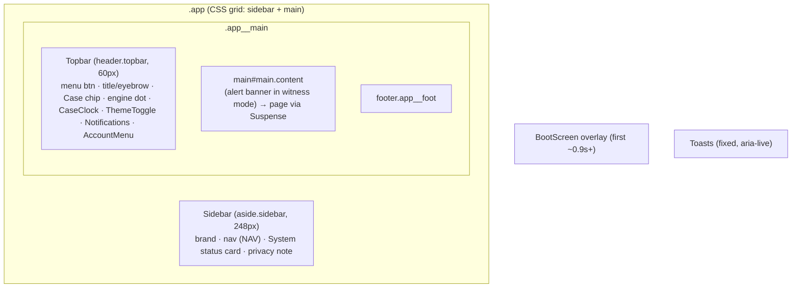
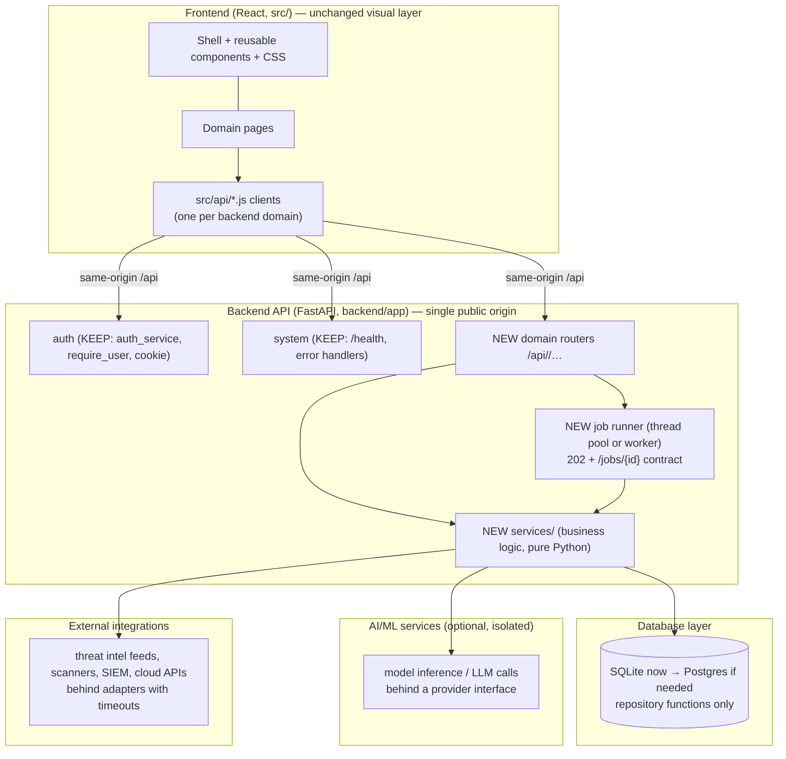
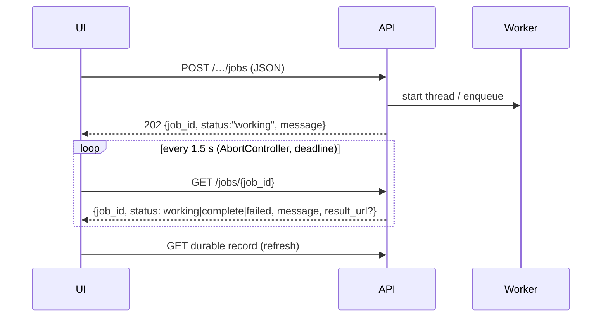
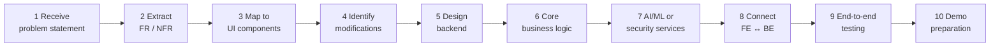

# MITIGATA.md — CyberForge 2026 Technical Reference

> **Purpose.** This is the main technical reference for adapting this copied project (originally *Revelio*, a forensic-composite workspace) for the **Mitigata CyberForge 2026** hackathon. It records what the codebase **actually contains** today, which parts of the UI can be kept, and how to swap the backend and business logic without changing the visual identity.
>
> **Scope.** This is documentation only. No source files were changed to produce it. The official problem statement has **not** been received yet, so nothing here assumes a particular CyberForge feature.
>
> **Verification convention.** Everything below comes from reading the files at the stated paths (snapshot: branch `shridhar`, HEAD `3786c31`, 2026-10-30). Anything that could not be confirmed from the code is marked **NOT VERIFIED**.

---

## Table of contents

1. [Project analysis](#1-project-analysis)
2. [UI architecture](#2-ui-architecture)
3. [Design system preservation](#3-design-system-preservation)
4. [Reusable component inventory](#4-reusable-component-inventory)
5. [Backend replacement strategy](#5-backend-replacement-strategy)
6. [API integration strategy](#6-api-integration-strategy)
7. [Future CyberForge adaptation](#7-future-cyberforge-adaptation)
8. [Development rules for Claude Code](#8-development-rules-for-claude-code)
9. [Future implementation workflow](#9-future-implementation-workflow)
10. [Architectural risks and dependencies](#10-architectural-risks-and-dependencies)
11. [Appendix: quick reference](#11-appendix-quick-reference)

---

## 1. Project analysis

### 1.1 What the existing project is

The project is **Revelio**, which turns a witness's description into a forensic sketch. It combines two codebases:

| Part | Role | Location |
|---|---|---|
| **Revelio frontend** | React SPA: marketing landing page, login/register pages, and the authenticated workspace | `src/`, `index.html`, `public/` |
| **Revelio API ("gateway")** | FastAPI service: accounts/sessions, procedural sketch engine, speech-to-text, and an **authenticated reverse proxy** to WitnessTrace | `backend/app/` |
| **WitnessTrace** | Second FastAPI service: cases, testimony, image revisions, Codex-CLI image generation jobs, reports, blockchain integrity | `witness-backend/` |
| **Vanilla tool pages** | Imperative JS image editors (Sketchpad, Enhance, Multi-view), shown in an `<iframe>` | `witness-backend/static/` |

The frontend has **two parallel page sets**. The build flag `VITE_WITNESSTRACE_LOCAL` picks one (see §1.10):

- **Witness mode (default, ON):** `WitnessWorkspace`, `WitnessStudio`, `WitnessLibrary`, `WitnessCompare`, `WitnessSettings`. These read and write WitnessTrace through `/wt-api`.
- **Legacy Revelio mode (`VITE_WITNESSTRACE_LOCAL=0`):** `Workspace`, `NewSketch`, `Library`, `Compare`, `Settings`. These use the Revelio `/api` sketch endpoints.

### 1.2 High-level architecture (as-is)



### 1.3 Languages

| Language | Where |
|---|---|
| JavaScript (ES modules, JSX) | `src/**`, `scripts/*.mjs`, `witness-backend/static/*.js` |
| CSS (plain, no preprocessor) | `src/index.css`, `src/styles/*.css`, `src/landing/landing.css`, `src/auth/auth.css`, `src/pages/witness.css`, `src/components/sketch/CompareSlider.css`, `witness-backend/static/*.css` |
| Python 3 | `backend/app/**`, `witness-backend/*.py`, test suites |
| HTML | `index.html`, `witness-backend/static/index.html` |
| Shell / Nginx / Docker | `docker/entrypoint.sh`, `docker/nginx.conf`, `Dockerfile`, `witness-backend/start.sh` |

**There is no TypeScript.** `@types/react` is a dev dependency only, used for editor hints.

### 1.4 Frontend framework and versions

Taken from `package.json` (declared) and `node_modules/*/package.json` (installed):

| Package | Declared | Installed | Purpose |
|---|---|---|---|
| `react` | `^19.2.4` | 19.2.4 | UI library |
| `react-dom` | `^19.2.4` | 19.2.4 | DOM renderer (`createRoot`) |
| `ethers` | `^6.17.0` | 6.17.0 | MetaMask / Base Sepolia transactions (`src/components/integrity/wallet.js`) |
| `vite` | `^8.0.0` | 8.3.5 | Dev server and bundler |
| `@vitejs/plugin-react` | `^6.0.0` | 6.0.1 | JSX/Fast Refresh |
| `eslint` | `^9.39.4` | 9.39.4 | Linting (flat config, `eslint.config.js`) |
| `eslint-plugin-react-hooks` | `^7.0.1` | — | Hooks rules |
| `eslint-plugin-react-refresh` | `^0.5.2` | — | Fast Refresh rules |
| `globals`, `@eslint/js`, `@types/react`, `@types/react-dom` | — | — | Tooling |

**Not used.** These have no dependency and no code: a CSS framework (no Tailwind or Bootstrap CSS), a component library, a router library, a state-management library, a data-fetching library (no React Query/SWR), a charting library, an animation library (no Framer Motion/GSAP), or an icon package. Everything is hand-written.

### 1.5 Backend frameworks and versions

| Service | File | FastAPI | Uvicorn | Pydantic | Pillow | Other |
|---|---|---|---|---|---|---|
| Revelio API (pinned for standalone use) | `backend/requirements.txt` | 0.135.1 | 0.38.0 | 2.12.1 | 12.0.0 | pytest 8.4.2, httpx 0.28.1 |
| Revelio gateway extra | `backend/requirements-integration.txt` | — | — | — | — | httpx 0.28.1 |
| Revelio speech (optional) | `backend/requirements-speech.txt` | — | — | — | — | faster-whisper 1.2.1, av 18.1.0 |
| WitnessTrace (runtime lock) | `witness-backend/requirements-runtime-lock.txt` | 0.162.0 | 0.54.0 | 2.14.1 | 12.3.0 | starlette 1.10.0, reportlab 4.5.1 |
| WitnessTrace tests | `witness-backend/requirements-test.txt` | — | — | — | — | pytest 9.2.0, httpx, playwright 1.63.0 |

> **Important:** `npm run dev` (`scripts/dev-integrated.mjs`) and the `Dockerfile` run **both** services from **one** Python environment (`witness-backend/.venv`, or the Docker image) built from the WitnessTrace lock file plus speech plus httpx. In practice, then, the Revelio API runs on FastAPI **0.162.0**, not 0.135.1. The local venv is Python **3.13.9**; the Docker image uses `python:3.14-slim`. `backend/.venv` does **not** exist in this copy.

### 1.6 Folder structure

```
ssdnexus-t1-20/
├── index.html                 # Vite entry; Google Fonts link; #root
├── package.json / package-lock.json
├── vite.config.js             # dev :5182, proxies /api and /wt-api → :8021
├── eslint.config.js
├── .env.example               # frontend env notes (VITE_API_BASE)
├── Dockerfile                 # 3-stage: web build → codex CLI → python runtime + nginx
├── docker-compose.yml         # one service "revelio", 127.0.0.1:8080, volume /data
├── render.yaml                # Render.com blueprint (Docker, free plan, no disk)
├── docker/
│   ├── nginx.conf             # serves dist/, proxies /api|/wt-api → 8021
│   └── entrypoint.sh          # starts WitnessTrace :8022, Revelio :8021, nginx
├── scripts/
│   ├── dev-integrated.mjs     # `npm run dev` — all three processes, port checks
│   ├── dev-all.mjs            # legacy: API :8000 + vite
│   ├── run-api.mjs            # legacy: backend/.venv uvicorn or pytest
│   ├── render-landing-assets.py
│   └── tests/                 # node --test adapter tests, python startup/integrity checks
├── public/                    # favicon, apple-touch-icon, landing/*.webp demo images
├── src/
│   ├── main.jsx               # path router: / → Landing, /login|/register → Auth, /app → App
│   ├── App.jsx                # workspace shell, boot sequence, hash-route page switch
│   ├── index.css              # DESIGN SYSTEM: tokens, base, buttons, inputs, tags, alerts…
│   ├── api/client.js          # Revelio /api client (fetch wrapper + ApiError)
│   ├── api/witnesstrace.js    # /wt-api client (validated, timeout, polling)
│   ├── state/AppContext.jsx   # global context: health, catalog, toasts, prefs, user…
│   ├── state/useWitnessCases.js # case/job state machine for witness mode
│   ├── lib/                   # router.js, nav.js, theme.js, auth.js, format.js
│   ├── components/
│   │   ├── shell/             # Sidebar, Topbar, Toasts, BootScreen
│   │   ├── ui/                # Icon, Modal, EmptyState, ThemeToggle, CaseClock, DictateButton
│   │   ├── brand/Logo.jsx     # LogoMark, BrandLogo, Wordmark (PNG assets)
│   │   ├── workflow/          # WorkflowStepper, GenerationStatus
│   │   ├── integrity/         # BlockchainIntegrity, IntegrityVisuals, wallet.js
│   │   └── sketch/            # domain components (traits, viewer, compare slider…)
│   ├── pages/                 # Workspace, NewSketch, Library, Compare, Settings,
│   │                          # WitnessStudio, WitnessTools, witness.css
│   ├── styles/app.css         # workspace layout + components (3,641 lines)
│   ├── styles/motion.css      # purposeful workflow animations (457 lines)
│   ├── landing/               # marketing page sections + landing.css (3,987 lines)
│   ├── auth/                  # AuthPage.jsx + auth.css
│   └── assets/brand/          # logo-mark.png, logo-wordmark.png
├── backend/                   # Revelio API (package `app`)
│   ├── app/main.py            # create_app(): routers, CORS, exception handlers
│   ├── app/config.py          # env-driven Settings, tiny .env loader
│   ├── app/database.py        # sqlite3 schema + connect() context manager
│   ├── app/schemas.py         # Pydantic request/response models
│   ├── app/catalog.py         # facial-trait catalog payload
│   ├── app/api/               # auth, system, sketches, traits, speech, witness_gateway
│   ├── app/services/          # auth_service, sketch_service, procedural_renderer, …
│   ├── app/providers/         # GenerationProvider interface + offline/local/hosted
│   └── tests/                 # 72 pytest tests
├── witness-backend/           # WitnessTrace service (flat modules)
│   ├── app.py                 # FastAPI app, routes, Codex job runner
│   ├── case_store.py          # SQLite schema + case/version/job persistence
│   ├── lab_schema.py, sketch_store.py, enhance_store.py, multiview_store.py,
│   │   report_store.py, integrity_store.py
│   ├── static/                # vanilla tool UI (+ Bootstrap Icons SVGs, MIT)
│   └── tests/                 # 72 pytest tests + fixtures
├── docs/integration/          # prior integration decisions, evidence, startup guide
├── README.md                  # project README (Revelio)
└── UI_INTEGRATION_HANDOFF.md  # earlier UI hand-off notes (118 KB)
```

### 1.7 Database architecture

There are **two independent SQLite databases** and no ORM. Both use the Python standard library `sqlite3` with raw SQL.

**A. Revelio DB**: `backend/app/database.py`, stored at `$REVELIO_DATA_DIR/revelio.db` (default `backend/data/`).

| Table | Key columns | Notes |
|---|---|---|
| `users` | `id`, `name`, `email UNIQUE`, `password_hash`, `created_at` | scrypt hashes |
| `sessions` | `token_hash PK`, `user_id → users`, `expires_at` | only the SHA-256 of the token is stored |
| `sketches` | `id TEXT PK`, `title`, `description`, `status`, `notes`, timestamps | legacy domain |
| `revisions` | `sketch_id → sketches`, `number`, `profile_json`, `method`, `is_ai`, `image_file`, `svg_file`, `notes_json` | legacy domain; files under `data/images/` |
| `activity` | `sketch_id`, `kind`, `message`, `created_at` | general-purpose activity log |

Connection pattern: one short-lived connection per call (`with connect() as conn:`), `PRAGMA foreign_keys = ON`, commit on success. The schema is created by `init_db()` in the FastAPI lifespan.

**B. WitnessTrace DB**: `witness-backend/case_store.py`, stored under `$WITNESSTRACE_DATA_DIR`, `PRAGMA journal_mode=WAL`, `timeout=10`.

Tables: `cases`, `statements`, `case_events`, `jobs`, `versions`, `version_details`, `selections`, `refinement_requests`, `local_edits`, `image_operations`, `multiview_requests`, `multiview_layouts`, `report_exports`, plus `blockchain_integrity` (`integrity_store.py`). Binary images live in `$WITNESSTRACE_OUTPUTS_DIR`; per-job scratch space is in `$WITNESSTRACE_WORK_DIR`.

**Tenancy:** none. Every signed-in user shares the same WitnessTrace case collection (stated in `docs/integration/ARCHITECTURE_DECISION.md`, and the code has no owner column).

### 1.8 API architecture

- REST over JSON. Errors use FastAPI's `{"detail": "..."}` shape. Mutations use POST/PUT/PATCH/DELETE.
- **One public origin.** The browser only talks to `/api/*` (Revelio) and `/wt-api/*` (the gateway to WitnessTrace). Vite (dev) or nginx (prod) proxy both to `127.0.0.1:8021`.
- `/wt-api/{path}` (`backend/app/api/witness_gateway.py`) is an **allowlist proxy**. It requires a Revelio session, rejects cross-origin mutations (Origin must match Host), requires JSON for POST/PUT, caps bodies at 48 MB, never forwards cookies, and serves the vanilla tool assets with path rewriting.
- Long-running work uses **HTTP 202 plus polling** (`/api/generate` → `/api/jobs/{id}`). There is **no WebSocket and no SSE** anywhere (verified by grep).

The full endpoint inventory is in [§5.1](#51-existing-routes-inventory).

### 1.9 Authentication

| Aspect | Implementation | File |
|---|---|---|
| Password hashing | `hashlib.scrypt` (N=2¹⁴, r=8, p=1, 16-byte salt) | `backend/app/services/auth_service.py` |
| Session | 32-byte `secrets.token_urlsafe`, **SHA-256 hash stored**, 7-day expiry | same |
| Cookie | `revelio_session`, `HttpOnly`, `SameSite=Strict`, `path=/`, **not `Secure`** (plain HTTP on loopback) | `backend/app/api/auth.py` |
| Guard | `require_user` dependency; `AUTH = [Depends(require_user)]` | same |
| Brute force | in-memory per-email throttle: 5 failures → 60 s lockout (resets on restart) | `auth_service.py` |
| Timing | dummy hash checked for unknown emails | `auth_service.py` |
| Frontend | `App` calls `api.me()`; a 401 redirects to `/login?next=…`; `safeNext()` only allows `/app…` | `src/App.jsx`, `src/lib/auth.js`, `src/api/client.js` |
| Logout | `POST /api/auth/logout` deletes the session and clears `revelio.draft` from localStorage | `src/state/AppContext.jsx` |

There are no roles, permissions, OAuth, or JWT.

### 1.10 Environment variables

**Frontend (Vite, build-time):**

| Variable | Default | Effect | Read in |
|---|---|---|---|
| `VITE_API_BASE` | `/api` | Base URL for the Revelio client | `src/api/client.js` |
| `VITE_WITNESSTRACE_LOCAL` | *(unset ⇒ witness mode ON)* | `'0'` switches to the legacy Revelio pages | `src/api/witnesstrace.js` |
| `REVELIO_API_URL` | `http://127.0.0.1:8021` | Vite proxy target for `/api` | `vite.config.js` |
| `REVELIO_GATEWAY_URL` | `http://127.0.0.1:8021` | Vite proxy target for `/wt-api` | `vite.config.js` |

**Revelio API:** read via `_env()`, which also accepts the legacy `VERISKETCH_*` prefix. `backend/.env` is loaded if present.

| Variable | Default |
|---|---|
| `REVELIO_DATA_DIR` | `backend/data` |
| `REVELIO_CORS_ORIGINS` | `localhost/127.0.0.1` on 5173 and 4173 *(the app is same-origin, so this rarely matters)* |
| `REVELIO_HOSTED_PROVIDER` | `""` (disabled); `gemini` enables it |
| `GEMINI_API_KEY`, `GEMINI_IMAGE_MODEL` | `""`, `gemini-3-pro-image-preview` |
| `REVELIO_HOSTED_TIMEOUT` | `90` |
| `REVELIO_LOCAL_MODEL_PATH` | `""` |
| `REVELIO_MAX_UPLOAD_MB` | `5` |
| `REVELIO_WHISPER_MODEL`, `REVELIO_WHISPER_DIR`, `REVELIO_WHISPER_OFFLINE` | set in Dockerfile (`base.en`, `/opt/whisper`, `1`) |
| `WITNESSTRACE_GATEWAY_TARGET` | must be `http://127.0.0.1:<port>`, port ≠ 8000/8001, or the gateway returns 503 |

**WitnessTrace:** `WITNESSTRACE_DATA_DIR`, `WITNESSTRACE_OUTPUTS_DIR`, `WITNESSTRACE_WORK_DIR`, `WITNESSTRACE_PORT` (start.sh), `CODEX_HOME`, `CODEX_BIN`, `CODEX_GENERATION_TIMEOUT` (600 s).

**Launcher:** `REVELIO_RUNTIME_DIR` (default `~/.local/share/revelio-witness`) is the root for `accounts/`, `data/`, `outputs/`, `work/`.

### 1.11 Existing integrations

| Integration | Kind | Where | Required? |
|---|---|---|---|
| **Codex CLI** (`codex exec`, OpenAI account) | subprocess, image generation | `witness-backend/app.py:run_job` | Optional; generation fails without it |
| **Google Gemini** image model | outbound HTTPS | `backend/app/providers/hosted_provider.py` | Off by default |
| **faster-whisper** | local speech-to-text | `backend/app/services/speech.py` | Optional |
| **Web Speech API** | browser STT fallback | `src/components/ui/DictateButton.jsx` | Browser-dependent |
| **MetaMask + ethers v6** | wallet, Base Sepolia (chain 84532) tx to sink `0x…dEaD` | `src/components/integrity/wallet.js` | Optional feature |
| **Base Sepolia public RPCs** (`sepolia.base.org`, publicnode, drpc) | outbound JSON-RPC for receipt verification | `witness-backend/integrity_store.py` | For integrity verify |
| **BaseScan** | outbound link only | `BlockchainIntegrity.jsx` | — |
| **Google Fonts** | CSS/font CDN | `index.html` | Visual fidelity |
| **ReportLab** | PDF report generation | `witness-backend/report_store.py` | WitnessTrace reports |

### 1.12 Build and deployment

| Command | What it does |
|---|---|
| `npm run dev` / `dev:all` | `scripts/dev-integrated.mjs`: checks that ports 5182/8021/8022 are free, then starts WitnessTrace :8022, Revelio :8021 (both via `witness-backend/.venv`), and Vite :5182 |
| `npm run dev:web` | Vite only |
| `npm run build` | `vite build` → `dist/` (git-ignored) |
| `npm run lint` | ESLint (ignores `dist`, `backend`, `witness-backend`) |
| `npm run test:adapter` | `node --test scripts/tests/witnesstrace.test.mjs` |
| `npm run test:api` / `dev:api` / `dev:legacy` | Legacy: require `backend/.venv` (absent in this copy) |
| `docker compose up` | Single container; nginx :8080 → 127.0.0.1:8080 on host; volume `/data`; mounts `~/.codex` |
| Render | `render.yaml`: Docker runtime, free plan, Singapore, health `/api/health`, **no persistent disk** |

There is **no CI configuration** (no `.github/`).

**Tests present:** `backend/tests` has 72 pytest functions, `witness-backend/tests` has 72, and `scripts/tests` has 11 node tests. Tests were **not run** for this document; whether they pass is **NOT VERIFIED** for the current working tree.

---

## 2. UI architecture

### 2.1 Entry points and routing

There are two levels of routing, both hand-written:

1. **Path routing** in `src/main.jsx`. It runs once on page load and lazy-loads the matching page:

   | Path | Component |
   |---|---|
   | `/` | `LandingPage` (`src/landing/LandingPage.jsx`) |
   | `/login`, `/register` | `AuthPage mode=…` (`src/auth/AuthPage.jsx`) |
   | `/app`, `/app/*` | `App` (`src/App.jsx`), which requires a session |
   | `/#/x` (old bookmark) | redirected to `/app#/x` |

2. **Hash routing** inside the workspace (`src/lib/router.js`): `#/route?key=value`, using `useRoute()` and `navigate(path, params)`. Valid routes come from `NAV` in `src/lib/nav.js`; unknown routes fall back to `workspace`.

### 2.2 Main application layout



`Shell` in `src/App.jsx` controls:

- **Boot sequence.** `BootScreen` shows four steps: `ui`, `engine` (`/api/health`), `catalog` (`/api/catalog`), and `providers`. It stays up for at least 900 ms, then fades over 420 ms.
- **Ready gate.** `ready = Boolean(health && catalog)`. If the gate fails, the shell renders `EngineOffline` instead of any page. **Note:** a new backend must still answer `/api/health` and `/api/catalog`, or this gate must be changed.
- **Page titles** come from the `TITLES` map: `[eyebrow, title]` per route.

### 2.3 Sidebar and navigation

- `src/components/shell/Sidebar.jsx`. Nav items come from `NAV` (`id`, `label`, `short`, `icon`) and show a numbered key (`01`, `02`, …). The active item gets `.is-active` and `aria-current="page"`.
- The "System status" card shows engine online/offline, version, and either WitnessTrace/Codex status (witness mode) or the provider list (legacy). **This content is hardcoded to the domain.**
- **Mobile (≤1080 px):** the sidebar becomes off-canvas (`translateX(-100%)`). It is opened by `.topbar__menu` and dismissed with `.sidebar-scrim`.

### 2.4 Dashboard structure (Workspace page)

The workspace exists in two variants that share the same CSS structure:

| Region | Classes | Legacy `Workspace.jsx` | Witness `WitnessWorkspace` |
|---|---|---|---|
| Hero | `.hero.panel.panel--corners.reveal`, `.hero__grid`, `.hero__text`, `.hero__visual` (animated logo reticle + numbered flow list) | ✓ | ✓ |
| KPI tiles | `.stats.stagger` > `.stat.panel` (`.label`, `.stat__value.mono`, optional `Icon`, `.stat__sub`) | 4 tiles from `/api/stats` | 4 tiles derived from case state |
| Main grid | `.workspace__grid` (main panel + `.workspace__side`) | Recent sketches cards | Revision list |
| Side panels | `.panel` + `.panel__head` + `.panel__body` | Unfinished work, Activity timeline, Providers | Case controls, Recent activity |
| Timeline | `ol.timeline` > `li.timeline__item.is-{kind}` (`.timeline__node`, `__msg`, `__time`) | ✓ | plain `<p>` rows |

### 2.5 Pages

| Page | File | Mode | Composition |
|---|---|---|---|
| Workspace | `src/pages/Workspace.jsx` | legacy | Hero, stats, recent cards, drafts, timeline, providers |
| WitnessWorkspace | `src/pages/WitnessStudio.jsx` (named export) | witness | Hero, stats, RevisionList, CaseControls, activity |
| NewSketch | `src/pages/NewSketch.jsx` (497 lines) | legacy | Studio grid: Description/Trait/Adjust/Refine panels, Mode selector, Viewer, Pipeline, RenderNotes, undo/redo reducer, localStorage draft |
| WitnessStudio | `src/pages/WitnessStudio.jsx` | witness | WorkflowStepper, studio grid (input / center viewer / side revisions), CharacterLab, Refinement, Deliverables, BlockchainIntegrity, GenerationStatus |
| Library | `src/pages/Library.jsx` | legacy | Toolbar + search, card grid, rename inline, status chip, HistoryModal, ConfirmModal delete |
| WitnessLibrary | `src/pages/WitnessTools.jsx` | witness | Search, card grid, RevisionList, Deliverables |
| Compare | `src/pages/Compare.jsx` | legacy | Picker toolbar, segmented view toggle, CompareSlider / split, meta `<dl>`, **diff `<table>`** |
| WitnessCompare | `src/pages/WitnessTools.jsx` | witness | Before/after selects, slider/split, attribute diff list |
| Settings | `src/pages/Settings.jsx` | legacy | Provider cards, privacy list + kv `<dl>`, switches, danger zone + typed-confirm modal |
| WitnessSettings | `src/pages/WitnessTools.jsx` | witness | Theme segmented control, reduce-motion switch, **status list** (dot + name + note + value), raw diagnostics `<details>` |
| Landing | `src/landing/*` | public | Nav, Hero (canvas "liquid composite"), Statement, Band, LiveDemo, Features, Workflow, EditorShowcase, Privacy, Capabilities, Pricing (`<table>`), FAQ, CTA, Footer |
| Auth | `src/auth/AuthPage.jsx` | public | Login/register form, client validation, engine status, password show toggle |

### 2.6 Cards and widgets

| Widget | CSS / component | Notes |
|---|---|---|
| Panel | `.panel`, `.panel--flat`, `.panel--corners` (accent corner brackets), `.panel__head`, `.panel__title`, `.panel__body` | The base container used everywhere |
| Stat tile | `.stat.panel` | Gradient surface, tabular numerals |
| Item card | `.lib-card.panel` (`__img`, `__body`, `__title`, `__meta`, `__actions`, `__export`), `.lib-card--enter` uses a `--i` stagger var | Library grid `.library__grid` |
| Sketch card | `.sketch-card` (`__img`, `__body`) | Workspace recent grid `.recent` |
| Draft row | `.draft-row`, `.is-local` | Linked list rows with chevron |
| Status card | `.status-card` (`__row`, `__meta`, `__providers`) | Sidebar |
| Provider card | `.provider`, `.is-ready` (`__head`, `__icon`, `__tags`, `__data`, `__detect`) | Settings |
| Status list | `.wt-status-list` | WitnessSettings |
| Key/value | `dl.kv`, `dl.viewer__meta`, `dl.compare-meta` | — |
| Chips/Tags | `.chip`, `.chip--{cyan,blue,amber,red,green}`; `.tag`, `.tag--{ai,procedural,local,remote,described,extracted,manual,unknown,conflict,uncertain}` | Status labels |
| Status dot | `.dot`, `.dot--{ok,warn,err,idle}`, `.dot--pulse` | — |

### 2.7 Tables

There is **no reusable table component.** Two plain `<table>` elements exist:

- `src/pages/Compare.jsx` uses `table.diff` with `tr.is-changed` row highlighting.
- `src/landing/Pricing.jsx` is a pricing comparison table (landing-scoped `lp-` CSS).

Sorting, pagination, column configuration, and virtualization do **not** exist.

### 2.8 Forms

| Element | Classes | Notes |
|---|---|---|
| Text input | `.input`, `.input--sm` | Focus = accent border + soft ring; `aria-invalid="true"` turns it red |
| Select | `.select`, `.select--sm` | Custom chevron via data-URI |
| Textarea | `.textarea` | Vertical resize |
| Field wrapper | `.field` + `.label` | — |
| Switch | `label.switch` > `input` + `.switch__track` + text span | Settings toggles |
| Segmented | `.segmented` > `button[aria-pressed]` | View toggles, theme picker |
| Search | `label.search` (icon + input) | Library |
| Auth fields | `.lp-auth__field`, `.lp-label`, `.lp-error`, `.has-error` | Separate landing-styled vocabulary |
| Witness forms | `.wt-fields`, raw `<input>`/`<select>` styled by `src/pages/witness.css` | **Inconsistent:** many witness-mode inputs omit `.input`/`.select` classes |

### 2.9 Charts and visualizations

**There is no charting library and no chart component.** The existing visualizations are:

- `IntegrityChain`, `HashFingerprint`, `ChainRecord` (`src/components/integrity/IntegrityVisuals.jsx`): a step chain, a byte-level hex-diff strip, and an on-chain record card.
- `WorkflowStepper` and `Pipeline`: horizontal step indicators.
- `GenerationStatus`: a stage list plus an indeterminate progress bar.
- `EmptyState` line-art SVG illustrations (`reticle`, `timeline`, `document`, `search`, `connection`, `compare`).
- Landing: a canvas "liquid composite" in `Hero.jsx`, `CountUp`, and a scroll-progress effect.

> A CyberForge dashboard that needs time-series, distribution, or graph charts will need a deliberate choice: hand-built inline SVG (no new dependency) or one small chart library. This is a **gap**, not an existing capability.

### 2.10 Modals and dialogs

`src/components/ui/Modal.jsx`:

- `Modal({ title, children, onClose, footer, wide, labelledBy })` locks body scroll (`body.is-locked`), autofocuses the first focusable element, traps Tab focus, closes on Escape or backdrop mousedown, and restores focus on unmount. Classes: `.modal-scrim`, `.modal.panel.panel--corners`, `.modal--wide`, `.modal__body`, `.modal__foot`.
- `ConfirmModal({ title, message, confirmLabel, danger, requireText, onConfirm, onClose, busy })` adds an optional "type X to confirm" field.

Dropdown dialogs (Topbar notifications and account menu) use the local `useDismiss` hook (outside click or Escape).

### 2.11 Notifications

- `notify({ kind: 'ok'|'info'|'warn'|'error', title, message, timeout=4200 })` lives in `AppContext`. It keeps the last 4 toasts and a 30-item session notification history.
- `Toasts.jsx` renders `.toasts` > `.toast.is-{kind}` with `role="alert"` for errors and `role="status"` otherwise.
- The Topbar bell (`.notif`) shows a count badge (max 9) and a panel listing with `relativeTime`. Notifications live **only in memory for the session**.

### 2.12 Loading states

| Pattern | Where |
|---|---|
| `.skeleton` shimmer blocks with inline sizes | `PageFallback` in `App.jsx`, Workspace, Library, Compare |
| `.spinner` (CSS border spinner) inside buttons | Retry, Re-check, ConfirmModal busy, logout |
| `BootScreen` with real step states (`pending/ok/error/skipped`) | App boot |
| `SketchViewer loading` prop: reticle overlay, optional scan sweep, "Processing" badge | Studio |
| `GenerationStatus` stage list + `role="progressbar"` | Witness studio |
| `aria-busy`, `aria-live="polite"` | Throughout |

### 2.13 Animations and transitions

There is no animation library; everything is CSS keyframes plus a few small JS hooks.

- `src/index.css`: `shimmer`, `dotPulse`, `fadeUp`, `fadeIn`, `scaleIn`, `spin`, `scanSweep`, `chipIn`, `workspaceEnter`, `softGlow`. Utilities `.reveal` (fade-up) and `.stagger > *` (50 ms steps).
- `src/styles/motion.css`: `signalPulse`, `barSlide`, `enterUp`, `nodePop`, `reticlePulse`, `sketchSharpen`, `warnPulse`, `revisionIn`, `revisionGlow`, `artBreathe`, `themeIconIn`. Entrance animations use `backwards` fill on purpose (see the file header).
- `src/styles/app.css`: `logoGlow`, `toastIn`, `sketchReveal`, `progressFast`, `progressIndeterminate`, `dictatePulse`.
- Theme cross-fade: the `.theme-anim` class is added for 400 ms on a user-initiated change (`src/lib/theme.js`).
- Landing (`src/landing/motion.jsx`): `Reveal`, `SplitLines`, `SplitWords`, `CountUp`, `useInView` (IntersectionObserver), `useScrollProgress`, intro loader, and `playOrb.js` (cursor-following ball).
- **Reduced motion** is respected twice: `@media (prefers-reduced-motion: reduce)` and the `.reduce-motion` class on `<html>`, which is toggled from the user preference `prefs.reduceMotion`.

### 2.14 Responsive design

Desktop-first `max-width` media queries, mainly in `src/styles/app.css`:

| Breakpoint | Effect |
|---|---|
| ≤1360 px, ≤1280 px | Grid tightening |
| **≤1080 px** | `--sidebar-w: 0`; sidebar off-canvas with scrim; menu/logo buttons appear; hero/workspace/compare grids → 1 column; hero visual hidden; studio grid → stacked `input / center / side` |
| ≤760 px | Content padding and topbar reductions |
| ≤420 px | Smallest-phone adjustments |
| `motion.css` ≤900 px, ≤560 px | Stepper/status compaction |
| ≥1081 px | Desktop-only rules |

The landing page has its own breakpoints in `landing.css`. Layout uses CSS Grid and Flexbox, `clamp()` for hero type, and `container-type: inline-size` on `.gen-status`.

### 2.15 State management

There is no external library. The pieces are:

| Layer | Mechanism | File |
|---|---|---|
| Global app state | React Context `AppContext` (`useApp()`) | `src/state/AppContext.jsx` |
| Witness case/job state | Custom hook `useWitnessCases()` (nested in context as `wt`) with request lock, epoch ticket to drop stale responses, AbortController polling | `src/state/useWitnessCases.js` |
| Page-local state | `useState`, `useReducer` (undo/redo history in `NewSketch`) | pages |
| Persistence | `localStorage` via `safeStorage` (try/catch wrapped) | `src/lib/format.js` |
| Cross-component events | `window` CustomEvents: `revelio-theme`, `witness-reports`, `witness-before-case`; `postMessage` `witness-saved` from the iframe (origin and source checked) | various |

**`AppContext` value:** `wt`, `catalog`, `loadCatalog`, `health`, `providers`, `engineError`, `refreshHealth`, `toasts`, `notify`, `dismissToast`, `notifications`, `clearNotifications`, `activeCase`, `setActiveCase`, `prefs`, `updatePrefs`, `user`, `logout`. Health is re-polled every **30 s**.

**localStorage keys:** `revelio.theme`, `revelio.prefs`, `revelio.draft`, `revelio.witness.case`, `revelio.intro.seen`, and a migration from `verisketch.*`.

---

## 3. Design system preservation

> ⚠️ **The CSS variable names are historical and misleading.** `src/index.css` defines a base palette (cyan/blue), then **overrides it twice further down** ("editorial gold", then the final palettes at the end of the file). The **effective** accent stored in `--cyan` is **vermilion `#ef5539` in dark mode** and **sage green `#527642` in light mode**. Always read the **last** matching block. Never "fix" a color by editing the first `:root` block; that block has no visible effect.

### 3.1 Effective color tokens (workspace, final cascade)

Source: `src/index.css`. Dark: `:root:not([data-theme='light'])` block near the end. Light: the second `:root[data-theme='light']` block.

| Token | Role | **Dark (default)** | **Light** |
|---|---|---|---|
| `--bg` | Page background | `#090909` | `#faf6e9` |
| `--bg-2` | Inset / input background | `#111111` | `#f5f1e2` |
| `--panel` | Surface | `#171717` | `#fffdf6` |
| `--panel-2` | Raised surface / button bg | `#202020` | `#fffdf6` |
| `--panel-3` | Hover surface | `#2b2b2b` | `#edf2d9` |
| `--border` | Hairlines | `#393632` | `#d5e1b9` |
| `--border-strong` | Emphasised borders | `#5b554e` | `#a0c878` |
| `--text` | Primary text | `#eee8dc` | `#273323` |
| `--text-2` | Secondary text (`.muted`) | `#c2b9aa` | `#56634c` |
| `--text-3` | Tertiary (`.faint`, `.label`) | `#8a8379` | `#747e69` |
| `--cyan` | **Primary accent** (focus, links, active) | **`#ef5539`** | **`#527642`** |
| `--blue` | Secondary accent | `#b7a992` | `#64854e` |
| `--amber` | Warning | `#ef5539` | `#ffb547` *(base, not overridden)* |
| `--green` | Success | `#8fa38b` | `#38d996` *(base)* |
| `--red` | Error | `#ff5d6c` *(base)* | `#ff5d6c` *(base)* |
| `--*-soft` | Tinted backgrounds | accent at 12–13% alpha | sage `rgba(160,200,120,.16–.2)` |
| `--cyan-line` | Accent hairline / corners | `rgba(239,85,57,.5)` | `rgba(160,200,120,.82)` |

**Primary button:** dark is solid `#ef5539` with text `#140b08` (hover `#ff674b`); light is a gradient `#a0c878 → #93bc6b` with text `#24311e`.

**Theme mechanics:** `<html data-theme="dark|light">`. The default is `dark`. Values persist in `localStorage['revelio.theme']` and are set before first paint by `initializeTheme()` in `main.jsx`. `index.html` meta `theme-color` = `#080B12`.

**Landing page:** uses its own `.lp`-scoped tokens (`--surface`, `--surface-2`, `--border-2`, `--violet`, `--ok`, `--warn`, `--grad`). These are also overridden in layers; the final palettes match the workspace (around `landing.css` lines 3130 (light) and 3181 (dark)).

### 3.2 Backgrounds and gradients

- **Body:** a solid `--bg` plus a faint **32 px grid** (two 1 px `linear-gradient`s) plus one soft radial glow (dark: `rgba(239,85,57,.045)` at the top-right; light: two sage radials). `background-attachment: fixed`.
- **Panels:** `linear-gradient(180deg, rgba(23,32,51,.72), rgba(18,25,39,.92))` base, overridden per theme near the end of `app.css` (`:root:not([data-theme='light']) .panel`, `:root[data-theme='light'] .app .panel`).
- **Stat tiles:** `linear-gradient(145deg, var(--panel-2), var(--panel))`.
- **Hero title (light):** gradient text `linear-gradient(130deg, #273323, #527642)`, Syne 800, uppercase, `letter-spacing: -0.065em`.
- **Landing `--grad`:** light `#a0c878 → #7fa95b → #527642`.

### 3.3 Typography

| Token | Value (effective) | Use |
|---|---|---|
| `--font` | `'Inter', ui-sans-serif, system-ui, …` | Body |
| `--display` | **`'Syne', 'Inter', 'Helvetica Neue', Arial, sans-serif`** (final override, both themes) | `h1–h4`, nav items, topbar title, hero |
| `--mono` | `'IBM Plex Mono', ui-monospace, 'SF Mono', Menlo, Consolas` | `.mono`, `.label`, IDs, numbers, clock |

**Loaded from Google Fonts (`index.html`):** Inter 400/500/600/700, IBM Plex Mono 400/500/600, Syne 400–800.
**NOT loaded:** `Manrope`. It is referenced by `landing.css` (`.lp h1–h3`) and the first `--display`, so it falls back to Inter unless installed locally. Also not loaded: `Iowan Old Style` (intermediate override, superseded).

| Element | Size / weight |
|---|---|
| Body | 14px / 400, line-height 1.5, `font-feature-settings: 'cv11','ss01'` |
| `.label` | 10.5px mono / 500, `letter-spacing: .14em`, uppercase, `--text-3` |
| `.panel__title` | 13.5px / 600 |
| Headings | display / 600, `letter-spacing: -0.02em`, line-height 1.15, `text-wrap: balance` |
| `.hero__title` | `clamp(30px, 3.8vw, 48px)`, `-0.05em` (light: `clamp(28px,3.1vw,44px)`, 800, uppercase) |
| `.btn` | 13px / 500 (`--primary` 600); `.btn--sm` 12.5px; `.btn--lg` 14px |
| Inputs | 13.5px |
| Landing body | 16px / 1.55 |

### 3.4 Spacing, radius, shadow, motion tokens

There is **no formal spacing scale.** Values are hard-coded per component, and the recurring ones are 8/10/12/14/16 px gaps, `16px` panel body padding, `14px 16px` panel head padding, and `36px` control height (30 sm / 44 lg).

| Token | Value |
|---|---|
| `--r-xs` / `--r-sm` / `--r-md` / `--r-lg` / `--r-xl` | 4 / 6 / 10 / 14 / 18 px (panels use `--r-lg`, buttons and inputs use `--r-md`) |
| Landing radii | `--r-pill 9999px`, `--r-card 1.75rem`, `--r-card-sm 1.125rem`, `--r-ctl .75rem` |
| `--shadow` (dark) | `0 1px 0 rgba(255,255,255,.025) inset, 0 12px 32px rgba(0,0,0,.28)` |
| `--shadow-lg` (dark) | `0 1px 0 rgba(255,255,255,.035) inset, 0 24px 64px rgba(0,0,0,.42)` |
| `--shadow` (light) | `0 1px 0 rgba(255,255,255,.9) inset, 0 10px 28px rgba(70,91,48,.08)` |
| `--focus` | `0 0 0 2px var(--bg), 0 0 0 4px <accent>` applied via `:focus-visible` box-shadow |
| `--ease` / `--ease-in-out` | `cubic-bezier(.2,.8,.2,1)` / `cubic-bezier(.65,0,.35,1)` |
| `--t-fast` / `--t` / `--t-slow` | 140 / 240 / 480 ms |
| `--sidebar-w` / `--topbar-h` | 248 px / 60 px |

### 3.5 Icons

- **Workspace and landing:** `src/components/ui/Icon.jsx` is a custom inline-SVG set of about **60 icons** on a 24 px grid. They use `stroke="currentColor"`, default `strokeWidth` 1.6, and round caps and joins. Default rendered size is 16 px (`.icon`). Props: `name`, `className='icon'`, `title`, `size`, `strokeWidth`.
  - Available names: `workspace newSketch library compare settings menu close plus minus check arrowRight arrowLeft chevronDown chevronRight undo redo reset save download upload trash edit search zoomIn zoomOut fit scan layers sparkle cpu cloud shield alert info error ok bell clock file json printer image users text list sliders wand eye eyeOff lock database history copy external dot more sun moon mic user logout micOff`.
  - **To add an icon:** add one entry to the `P` map, using the same stroke style. Do not add an icon package.
- **Vanilla tools (`witness-backend/static/icons/`):** a subset of **Bootstrap Icons** SVGs (MIT, `LICENSE` included).
- **Brand:** `src/assets/brand/logo-mark.png` (owl mark) and `logo-wordmark.png` (554×170 ratio), via `LogoMark` and `BrandLogo`.

### 3.6 Button styles (`src/index.css`)

| Class | Look |
|---|---|
| `.btn` | `--panel-2` bg, `--border-strong` border, `--r-md`, min-height 36 px, 0 14 px padding, gap 8 px; hover → `--panel-3`; active → `translateY(1px) scale(.985)`; disabled → opacity .45 |
| `.btn--primary` | Accent fill (see §3.1) |
| `.btn--blue` | `--blue` fill, white text |
| `.btn--ghost` | Transparent; hover shows a faint fill and border |
| `.btn--danger` | `--red-soft` fill, red border/text |
| `.btn--sm` / `.btn--lg` / `.btn--icon` / `.btn--block` | Size and shape modifiers (icon = 36×36, sm icon = 30×30) |

Buttons use **CSS custom properties** (`--btn-bg`, `--btn-border`, `--btn-color`), so variants only reassign variables. Keep that pattern.

### 3.7 Input styles

`.input/.select/.textarea` have a `--bg-2` background, `--border` hairline, `--r-md` radius, and 8×11 px padding. Hover → `--border-strong`. Focus → accent border + `0 0 0 3px var(--cyan-soft)` ring. Invalid → red border.

### 3.8 Component design conventions (keep these)

1. **BEM-like class naming:** `block__element`, `block--modifier`, state as `is-*` (`is-active`, `is-open`, `is-ok`, `is-running`, `is-new`, `is-selected`). Landing classes are prefixed `lp-`; WitnessTrace classes are prefixed `wt-`.
2. **Panels everywhere:** `section.panel` > `.panel__head` (`h2.panel__title.section-title`, optional right-side action) + `.panel__body`. `.section-title::before` draws the rotated-square accent glyph.
3. **"Forensic workstation" feel:** mono uppercase micro-labels, mono IDs and timestamps, corner-bracket panels (`.panel--corners`), status dots, a 32 px grid background.
4. **Honesty conventions** (an explicit project value, visible in comments): every status shown reflects a real check ("never a decorative 'live' badge", `src/landing/engine.jsx`). AI output is labelled as such. No fake progress sub-steps (`GenerationStatus.jsx`).
5. **Accessibility:** skip link, `aria-current`, `aria-live`, `role="status"/"alert"`, `.sr-only` text for state, focus trap in modals, keyboard support in `CompareSlider`, and reduced motion.
6. **Every theme-specific override is written for both themes** (`:root[data-theme='light'] …` and `:root:not([data-theme='light']) …`).

---

## 4. Reusable component inventory

Legend: **A** = reuse with no change · **B** = reuse with modifications · **C** = project-specific, replace.

### 4.1 Category A: reusable without modification

| Component | File | Purpose | Props / interface | Dependencies |
|---|---|---|---|---|
| `Icon` | `src/components/ui/Icon.jsx` | Inline SVG icon set | `name`, `className='icon'`, `title?`, `size?`, `strokeWidth=1.6` | none |
| `Modal` | `src/components/ui/Modal.jsx` | Accessible dialog (focus trap, Escape, scroll lock) | `title`, `children`, `onClose`, `footer?`, `wide?`, `labelledBy='modal-title'` | `Icon` |
| `ConfirmModal` | same | Confirm/destructive dialog with optional typed confirmation | `title`, `message`, `confirmLabel`, `danger`, `requireText?`, `onConfirm`, `onClose`, `busy` | `Modal` |
| `EmptyState` | `src/components/ui/EmptyState.jsx` | Empty / no-results / offline states with line art | `icon='scan'`, `art?` (`reticle`/`timeline`/`document`/`search`/`connection`/`compare`/`none`), `title`, `children`, `action?`, `compact?` | `Icon` |
| `ThemeToggle` | `src/components/ui/ThemeToggle.jsx` | Dark/light switch | `className` | `lib/theme` |
| `CaseClock` | `src/components/ui/CaseClock.jsx` | Live local date/time (mono). Fits SOC "operator clock" use | none | none |
| `Toasts` | `src/components/shell/Toasts.jsx` | Toast stack | none (reads `useApp().toasts/dismissToast`) | `AppContext`, `Icon` |
| `CompareSlider` | `src/components/sketch/CompareSlider.jsx` + `.css` | Drag/keyboard before-after image reveal | `before`, `after` (image URLs), `beforeLabel`, `afterLabel` | none |
| `WorkflowStepper` | `src/components/workflow/WorkflowStepper.jsx` | Generic step tracker; caller computes state | `steps: [{id, label, detail, state: done|current|active|pending|blocked|error, onSelect?}]`, `label` | `Icon` |
| `Pipeline` | `src/components/sketch/Pipeline.jsx` | Vertical step list | `steps: [{id, label, detail, state: done|active|warn|…}]` | `Icon` |
| `IntegrityChain`, `HashFingerprint` | `src/components/integrity/IntegrityVisuals.jsx` | SHA-256 byte diff strip; step chain | `HashFingerprint({original, current})` is fully generic (64-hex strings) | none |
| `useRoute`, `navigate` | `src/lib/router.js` | Hash router | `navigate(path, params)` | React |
| `useTheme`, `applyTheme`, `initializeTheme` | `src/lib/theme.js` | Theme state + persistence | — | React |
| `safeStorage`, `formatDateTime`, `relativeTime`, `downloadBlob`, `humanize` | `src/lib/format.js` | Utilities | — | none |
| `safeNext`, `loginUrl` | `src/lib/auth.js` | Safe post-login redirect | — | none |
| `request()` / `ApiError` core | `src/api/client.js` | fetch wrapper, error normalisation, 401 → login | internal | `lib/auth` |
| `AuthPage` | `src/auth/AuthPage.jsx` | Login/register | `mode: 'login'|'register'` | `api.me/login/register`, `Logo` (brand copy is the only change) |
| CSS primitives | `src/index.css` | `.panel`, `.btn*`, `.input*`, `.chip*`, `.tag`, `.dot*`, `.alert*`, `.skeleton`, `.spinner`, `.segmented`, `.switch`, `.label`, `.mono`, `.reveal`, `.stagger` | — | — |

### 4.2 Category B: reusable with modifications

| Component | File | Purpose | Props / interface | Required modifications |
|---|---|---|---|---|
| **Shell** | `src/App.jsx` | Layout, boot, page switch | — | Replace `TITLES`, page switch, `EngineOffline` copy (mentions "composites"), footer text, witness alert banner; revisit `ready = health && catalog` gate |
| `Sidebar` | `src/components/shell/Sidebar.jsx` | Primary nav + system status | `current`, `open`, `onNavigate`, `onClose` | Nav list is generic (driven by `NAV`); **status card** hardcodes Revelio/WitnessTrace/Codex/provider semantics → feed from new `/api/health` shape; tagline text |
| `Topbar` | `src/components/shell/Topbar.jsx` | Header, notifications, account | `title`, `eyebrow`, `onMenu` | "Case" chip ← `activeCase` (rename to the new domain's primary entity, e.g. *Incident*/*Scan*); "LOCAL/OFFLINE" label; otherwise generic |
| `AccountMenu` | inside `Topbar.jsx` | Avatar menu + logout | `user`, `onLogout` | Copy only |
| `BootScreen` | `src/components/shell/BootScreen.jsx` | Real startup checks | `steps: {key: state}`, `leaving` | Edit `STEP_LABELS` and tagline |
| `NAV` | `src/lib/nav.js` | Route list | `{id, label, short, icon}` | Replace entries; `TITLES` in `App.jsx` must match |
| `AppContext` | `src/state/AppContext.jsx` | Global state | see §2.15 | Remove `wt`/`catalog`/`providers` (domain); keep `health`, `notify`, `toasts`, `notifications`, `prefs`, `user`, `logout`; add new domain state or hooks |
| `SketchViewer` | `src/components/sketch/SketchViewer.jsx` | Zoomable image viewer, compare, download, meta `<dl>`, loading/error overlay | `src, kind, label, sublabel, loading, error, before?, onDownload, downloadBusy, meta=[[k,v]], empty` | Rename tags ("AI-generated"/"Procedural"), corner label "VIEW · RASTER". Usable for screenshots, evidence images, rendered graphs |
| `GenerationStatus` | `src/components/workflow/GenerationStatus.jsx` | Job progress | `job {job_id|id, status: working|complete|failed, message}`, `versions`, `error` | Make `STAGES` a prop; drop the `versions` "saved" check. Fits scan/analysis/ingest jobs |
| `BlockchainIntegrity` | `src/components/integrity/BlockchainIntegrity.jsx` | Hash-commitment registration and verification on Base Sepolia | `caseId`, `versionId` | Tied to WitnessTrace `/integrity` route and commitment prefix `revelio:image:v1:sha256:` (`wallet.js`). Fits **evidence chain of custody** if kept; otherwise C |
| `ChainRecord` | `IntegrityVisuals.jsx` | On-chain record card | `result`, `txHash`, `sink` | Expects WitnessTrace integrity result shape |
| `RenderNotes` | `src/components/sketch/RenderNotes.jsx` | Sorted notice list with kind badges | `notes: [{kind, message, trait}]` | Rename `KIND` map (e.g. `critical/high/medium/info`) → findings list |
| `ModeSelector` | `src/components/sketch/ModeSelector.jsx` | Radio-card selector of providers with availability | `mode`, `onChange` (reads `providers`) | Pass options as props instead of context → engine/scanner selector |
| `ReferenceUpload` | `src/components/sketch/ReferenceUpload.jsx` | Validated file picker → data URL | `value`, `onChange({dataUrl,name,size})`, `supported`, `providerLabel` | Hardcoded image MIME list and 5 MB; generalise for log/PCAP/JSON uploads (binary uploads should not use data URLs) |
| `DictateButton` | `src/components/ui/DictateButton.jsx` | Speech-to-text into a field | `value`, `onChange`, `maxLength?`, `label`, `lang?` | Depends on `/api/speech*`; renders nothing if unsupported. Optional feature |
| `Workspace` (layout) | `src/pages/Workspace.jsx` | Dashboard: hero + KPI tiles + list + timeline | — | Keep structure and classes; replace data calls, copy, hero flow list |
| `Library` (layout) | `src/pages/Library.jsx` | Searchable card grid with actions, delete confirm, history modal | — | Rebind to the new entity list; keep debounce search (220 ms), stagger, remove animation |
| `Compare` (layout) | `src/pages/Compare.jsx` | Two-picker diff with `table.diff` | `params` | Rebind to snapshot/scan diff; table is the only existing table styling |
| `Settings` / `WitnessSettings` (layout) | `src/pages/Settings.jsx`, `WitnessTools.jsx` | Provider cards, switches, status list, danger zone | — | Replace rows with integration health (API keys present, feeds reachable). Keep switches and typed-confirm wipe |
| `RevisionList` | `src/pages/WitnessTools.jsx` | Version list with "newly saved" highlight | reads `wt` | The "new item" diffing pattern is reusable; data binding is domain-specific |
| `createWitnessClient` / `pollJob` | `src/api/witnesstrace.js` | Validated client with timeout, abort, polling | `createWitnessClient(fetcher, timeout)`, `pollJob(client, id, {signal,onStatus,interval,deadline})` | **Template** for any new job-based API; replace base path, validators, ID regex |
| `useWitnessCases` | `src/state/useWitnessCases.js` | Select/act/follow state machine | — | **Pattern** reusable (lock, epoch, abort); domain calls replaced |
| Logo components | `src/components/brand/Logo.jsx` | Brand images | `size`, `height`, `animated` | Swap PNGs if rebranding; keep component API |
| Landing page | `src/landing/*` | Marketing site | — | Layout/motion reusable; nearly all copy, demos, pricing are Revelio-specific (see C) |

### 4.3 Category C: project-specific, should be replaced

| Component | File | Why |
|---|---|---|
| `TraitPanel`, `SourceTag` | `src/components/sketch/TraitPanel.jsx` | Facial-trait catalog editor |
| `DescriptionPanel`, `GuidedForm` | `src/components/sketch/DescriptionPanel.jsx` | Witness description input, examples |
| `WitnessMerge` | `src/components/sketch/WitnessMerge.jsx` | Multi-witness trait merge |
| `RefinePanel` | `src/components/sketch/RefinePanel.jsx` | Natural-language trait refinement |
| `AdjustPanel` | `src/components/sketch/AdjustPanel.jsx` | Facial proportion sliders |
| `NewSketch` | `src/pages/NewSketch.jsx` | Composite builder (the undo/redo reducer `historyReducer` is worth copying) |
| `WitnessStudio`, `CaseControls`, `workflowSteps()` | `src/pages/WitnessStudio.jsx` | Case/testimony workflow (the studio **grid layout** `.studio__grid` is reusable) |
| `CharacterLab`, `Refinement`, `ProcessingTools`, `Deliverables` | `src/pages/WitnessTools.jsx` | 45-attribute lab, Codex refine, iframe editors, PDF reports |
| Vanilla tools | `witness-backend/static/*` | Sketchpad/Enhance/Multi-view canvas editors |
| Landing content | `Hero.jsx` (LiquidComposite), `LiveDemo.jsx`, `EditorShowcase.jsx`, `sketches.js`, `Pricing.jsx` (PLANS/ROWS), `Trust.jsx` (NUMBERS/CAPS), `Sections.jsx` copy, `Closing.jsx` FAQ, `constants.js` REPO_URL | Revelio marketing copy and demos |
| `format.js` domain helpers | `optionLabel`, `markLabel`, `profileSummary`, `emptyProfile` | Trait-specific |

---

## 5. Backend replacement strategy

### 5.1 Existing routes inventory

**Revelio API** (`backend/app/api/*`, prefix `/api`). 🔒 means `require_user` applies.

| Method | Path | Auth | Router | Domain? |
|---|---|---|---|---|
| POST | `/auth/register` | — | auth | **Keep** |
| POST | `/auth/login` | — | auth | **Keep** |
| POST | `/auth/logout` | — | auth | **Keep** |
| GET | `/auth/me` | 🔒 | auth | **Keep** |
| GET | `/health` | — | system | **Keep endpoint, change payload** (`{status, app, version, renderer, providers[]}`) |
| GET | `/catalog` | — | system | Domain (facial traits). **Boot gate depends on it** |
| GET | `/providers` | — | system | Domain |
| GET | `/stats` | 🔒 | system | Domain (counts) |
| GET | `/activity?limit=` | 🔒 | system | Generic pattern; domain data |
| GET | `/storage` | 🔒 | system | Generic-ish |
| POST | `/data/delete-all` | 🔒 | system | Generic pattern (`{confirm:"DELETE"}`) |
| POST | `/traits/extract`, `/refine/parse`, `/refine/apply`, `/witnesses/merge` | — | traits | Domain (**unauthenticated**) |
| POST | `/render`, `/render.png` | — | sketches | Domain (**unauthenticated**) |
| GET/POST/PATCH/DELETE | `/sketches…` (list, generate, get, update, delete, revisions, image.png/svg, export.json, report) | 🔒 | sketches | Domain |
| GET | `/speech` | — | speech | Optional feature |
| POST | `/speech/transcribe?lang=` | 🔒 | speech | Optional feature |
| GET/POST/PUT | `/wt-api/{path}` (no `/api` prefix) | 🔒 | witness_gateway | Domain proxy; **the pattern is reusable** |

**WitnessTrace** (`witness-backend/app.py`, reached via `/wt-api/…`): `/api/health`, `/api/cases` (list/create), `/api/cases/{id}` (get/put), `/freeze`, `/clarifications`, `/api/lab-schema`, `/prompt-preview`, `/selection`, `/refinement-preview`, `/refine` (202), `/api/generate` (202), `/api/jobs/{id}`, `/images/{id}`, sketch and enhance edits, `/imports`, `/enhancements`, `/api/enhance-schema`, multiview (preview/history/generate 202/layouts/panels), reports (create/list/preview/download), `export.png`, `export.json`, `/integrity` (GET verify / POST register).

### 5.2 Controllers, services, models

| Layer | Revelio (`backend/app`) | WitnessTrace (`witness-backend`) |
|---|---|---|
| Controllers / routers | `api/auth.py`, `system.py`, `sketches.py`, `traits.py`, `speech.py`, `witness_gateway.py` | Route functions directly in `app.py` |
| Services | `services/auth_service.py` ✅ generic; `sketch_service.py`, `procedural_renderer.py` (1,019 lines), `trait_extractor.py` (531), `refinement_service.py`, `merge_service.py`, `report.py`, `uploads.py` (image validation), `speech.py` | `case_store.py` (543), `sketch_store.py`, `enhance_store.py`, `multiview_store.py`, `report_store.py`, `integrity_store.py` |
| Models / schemas | `schemas.py` (Pydantic: `TraitValue`, `Mark`, `Profile`, requests, `RegisterRequest`, `LoginRequest`) | Pydantic models inside each `*_store.py`; `lab_schema.py` field definitions |
| Provider abstraction | `providers/base.py`: `GenerationProvider` (`id`, `label`, `kind`, `runs_locally`, `status()`, `generate()`, `describe()`), `ProviderError`, `ProviderUnavailable`; `registry.py` | — |
| Error mapping | `main.py`: `NotFound`→404, `UploadError`→422, `ProviderUnavailable`→409, `ProviderError`→502 (`provider_error: true`), `ValueError`→422, validation→422 with `errors[]`, unhandled→500 (no internals leaked) | `HTTPException` per route |

### 5.3 Background tasks and real-time

| Mechanism | Location | Behaviour |
|---|---|---|
| Thread per job | `witness-backend/app.py` (`threading.Thread(target=durable_run_job, daemon=True)`) | Runs `codex exec` subprocess with timeout (600 s) |
| Global generation lock | `_guard = threading.Lock()` | **Only one generation at a time**; a concurrent request gets HTTP 409 |
| Job persistence | `case_store.start_job/finish_job/job_status` | State survives in SQLite; in-memory `_jobs` dict for live status |
| Client polling | `pollJob` in `src/api/witnesstrace.js` | 1,500 ms interval, 660 s deadline, abortable |
| Health polling | `AppContext` | `/api/health` every 30 s |
| WebSockets / SSE / queue (Celery, RQ, Redis) | — | **None** |

### 5.4 External dependencies to drop or keep

| Dependency | Used by | Keep for CyberForge? |
|---|---|---|
| FastAPI, Uvicorn, Pydantic, httpx | both | **Keep** (generic, already pinned) |
| Pillow | procedural renderer, uploads, WitnessTrace | Keep only if images are processed |
| ReportLab | WitnessTrace PDF reports | Keep if PDF reports are required |
| faster-whisper / av | dictation | Optional (large Docker layer and model download) |
| Codex CLI | image generation | Drop unless needed |
| ethers (frontend) | blockchain integrity | Keep only if an evidence-integrity feature is in scope |

### 5.5 Recommended separation of concerns



Rules for the split:

- **Frontend:** presentation, client validation, and view state only. It never holds secrets and never calls external services directly. Everything goes through same-origin `/api`. This is already enforced by convention (comments in `src/api/client.js`, `.env.example`).
- **Backend API:** authentication, authorisation, input validation (Pydantic), orchestration, and error normalisation into `{detail}`.
- **Services:** pure business logic, unit-testable without HTTP.
- **Database:** accessed only from services through small repository functions (current style: `with connect() as conn`).
- **AI/ML:** behind an interface like `providers/base.py` (`status()` / `run()` / `describe()`), so offline/mock and real backends can be swapped and labelled honestly.
- **External integrations:** adapters with explicit timeouts, `trust_env=False` style isolation (as in the gateway), and errors mapped to `502/503/504` with safe messages.

### 5.6 Replacement options

| Option | Description | Pros | Cons |
|---|---|---|---|
| **1 (recommended)** Single FastAPI service | Keep `backend/app` (auth, health, error handlers, config, DB helper). Add new `api/<domain>.py` + `services/<domain>_*.py`. Retire `witness_gateway`, sketches/traits/speech routers, and `witness-backend/` | One process, one port, one venv, simple Docker. Auth reuse is free | Long-running ML work must be moved off the request thread |
| 2 Separate domain service behind the gateway | Keep the `/wt-api`-style allowlist proxy pattern, pointed at a new service on 127.0.0.1:8022 | Isolates heavy dependencies (ML) and crashes | Allowlist regexes must be rewritten. Two services to run. More moving parts in a hackathon |

**Steps for Option 1 (no frontend breakage):**

1. Keep `/api/auth/*` and `/api/health` contracts as they are. Extend the `/api/health` payload, keeping `status` and `version` because `Sidebar` and `Settings` read `health.version`.
2. Decide what happens to `/api/catalog`. Either serve a new domain "catalog" (enums, schema, config the UI needs at boot) or change `Shell`'s `ready` gate and `BootScreen` steps. **Do one of these before removing `catalog.py`.**
3. Add new routers with `dependencies=AUTH` on everything that reads or writes saved data. **Do not repeat** the current pattern of leaving compute endpoints (`/render`, `/traits/extract`) unauthenticated without a reason.
4. Build the frontend with `VITE_WITNESSTRACE_LOCAL=0` (or remove witness mode) so `/wt-api` is no longer called, then delete the gateway router and `witness-backend/` in a separate commit.
5. Update `scripts/dev-integrated.mjs`, `Dockerfile`, and `docker/entrypoint.sh` together (they hard-code both services and ports 8021/8022).

---

## 6. API integration strategy

### 6.1 Client configuration

| Client | File | Base URL | Credentials | Timeout | Validation |
|---|---|---|---|---|---|
| `api` | `src/api/client.js` | `import.meta.env.VITE_API_BASE || '/api'` | Browser default (same-origin cookie is sent) | none | none |
| `witness` | `src/api/witnesstrace.js` | `/wt-api` (fixed) | `credentials: 'same-origin'` | 15 s (AbortController) | Per-call `validate()` on response shape; 32-hex ID regex |

**Dev proxy** (`vite.config.js`): `/api` → `REVELIO_API_URL` and `/wt-api` → `REVELIO_GATEWAY_URL` (both default `http://127.0.0.1:8021`). **Prod:** nginx `location ~ ^/(api|wt-api)/` → `127.0.0.1:8021`, preserving `Host` and `X-Forwarded-Proto`.

### 6.2 Request and response patterns

```js
// src/api/client.js (abridged) — the canonical request helper
async function request(path, { method = 'GET', body, blob, signal, raw = false } = {}) {
  let res
  try {
    res = await fetch(`${BASE}${path}`, {
      method, signal,
      headers: body !== undefined ? { 'Content-Type': 'application/json' }
        : blob ? { 'Content-Type': blob.type || 'application/octet-stream' } : undefined,
      body: body !== undefined ? JSON.stringify(body) : blob,
    })
  } catch (err) {
    if (err?.name === 'AbortError') throw err
    throw new ApiError(0, 'The local Revelio engine is not reachable. …')   // status 0 = offline
  }
  if (!res.ok) {
    if (res.status === 401 && !path.startsWith('/auth/') && window.location.pathname.startsWith('/app'))
      window.location.assign(loginUrl())                                     // session expired
    let data = {}; try { data = await res.json() } catch {}
    throw new ApiError(res.status, typeof data.detail === 'string' ? data.detail : `Request failed (${res.status})`, data)
  }
  if (raw) return res
  if (res.status === 204) return null
  return res.json()
}
```

- **JSON in, JSON out.** Binary uploads use `blob` (`/speech/transcribe`). Downloads are plain `<a href>` URLs (`exportJsonUrl`, `pngDownloadUrl`, `reportUrl`) so the browser handles `Content-Disposition`.
- **Errors:** `ApiError { status, message, data }`, with getters `isOffline` (status 0) and `isProviderError`. The backend always returns `{detail: string}` (plus `errors[]` on 422).
- **Authentication headers:** **none.** Auth is purely the `HttpOnly` `revelio_session` cookie. No `Authorization` header and no CSRF token. CSRF protection relies on `SameSite=Strict` plus the gateway's Origin check for `/wt-api` mutations.
- **401 handling:** automatic redirect to `/login?next=…` from anywhere under `/app`.

### 6.3 Error handling and UI state conventions

Pages consistently follow this shape:

```jsx
const [data, setData] = useState(null)     // null = loading
const [error, setError] = useState(null)
useEffect(() => {
  let cancelled = false
  api.something().then(d => !cancelled && setData(d)).catch(e => !cancelled && setError(e.message))
  return () => { cancelled = true }
}, [])
// render: error → <div className="alert alert--error"><Icon name="error" />…</div>
//         !data → <div className="skeleton" style={{ height: 120 }} />
//         empty → <EmptyState … />
//         else  → content
```

User-triggered actions report results through `notify({kind, title, message})`. The witness client adds idempotency rules: never auto-retry an ambiguous POST, read durable state before resubmitting, and use per-request keys (`request_key`) for refine/report.

### 6.4 Long-running job contract (reuse this)



`GenerationStatus` and `pollJob` already render and drive this contract. A new backend that uses the same `{job_id, status, message}` shape gets progress UI with no change to those components.

### 6.5 WebSocket architecture

**Not present.** If live monitoring (streaming alerts or logs) becomes a requirement, either:

- keep polling (zero new infrastructure; matches the current pattern), or
- add a single SSE endpoint (`StreamingResponse`) behind the same cookie auth. **nginx would need `proxy_buffering off`** for that location. This would be **new architecture**; document it before adding.

### 6.6 Adapting the clients to a new backend

1. Create **one module per domain**, e.g. `src/api/<domain>.js`, built from `request()` in `client.js`. Add a timeout and a `validate()` the way `createWitnessClient` does for anything critical.
2. Keep `api.me/login/register/logout/health` in `client.js`.
3. Replace domain helpers (`listSketches`, `generate`, …) gradually. Stop calling them before removing their routes.
4. Update the `ApiError(0, …)` offline message text, which currently mentions "Revelio engine" and `npm run dev:api`.
5. Keep download links as URLs returned or built by the client. Never hard-code `/api` in components (`assetUrl()` exists for this).

---

## 7. Future CyberForge adaptation

> These domains are **preparation areas, not requirements.** Nothing below is implemented. The mappings show where each future need would fit in the existing UI.

### 7.1 Generic primitive mapping

| Existing UI element | Generic meaning | Example CyberForge reuse |
|---|---|---|
| `Workspace` hero + `.stats` tiles | Overview dashboard + KPIs | Open alerts, critical vulns, assets online, MTTR |
| `.timeline` activity list | Ordered event log | Alert stream, attack chain events |
| `Library` card grid + search + confirm delete | Entity inventory | Assets, incidents, IOCs, scans, integrations |
| `Compare` pickers + `table.diff` | Snapshot diff | Scan-to-scan changes, config drift |
| Studio grid (`.studio__grid`: input / center / side) | Workbench | Investigation console, analysis input → result → history |
| `WorkflowStepper` | Multi-stage process | IR lifecycle (Detect→Triage→Contain→Eradicate→Recover), integration setup wizard |
| `GenerationStatus` + `pollJob` | Async job progress | Scan, enrichment, ingestion, model inference |
| `RenderNotes` | Typed findings list | Severity-tagged findings, rule hits |
| `SketchViewer` | Zoomable artefact viewer | Screenshot of phishing page, evidence image, rendered graph PNG |
| `HashFingerprint` / `IntegrityChain` / `BlockchainIntegrity` | Integrity verification | Evidence hash verification, chain of custody |
| `Settings` provider cards / status list | Integration health | Feed/API connectivity, key configured, last sync |
| `ModeSelector` | Engine choice with availability | Choose scanner / model / data source |
| `Modal`, `ConfirmModal` | Dialogs | Details, destructive actions (typed confirm) |
| Toasts + Topbar notifications | Feedback | Job finished, new critical alert |
| `.chip`/`.tag`/`.dot` | Status/severity | Severity, state, online/offline |
| Topbar "Case" chip | Active entity context | Active incident / investigation |

### 7.2 Domain-by-domain mapping

| Domain | Likely pages (reusing existing layouts) | Reused components | Known gaps |
|---|---|---|---|
| **Security operations** | Overview (Workspace), Alerts (Library), Alert detail (Studio), Settings | stats, timeline, cards, chips, notifications, stepper | Data table with sort/filter; charts |
| **Attack reconstruction** | Incidents (Library), Reconstruction workbench (Studio), Compare | timeline, `WorkflowStepper`, `RenderNotes`, `SketchViewer` | Graph/kill-chain visualisation (none exists) |
| **Integration automation** | Integrations (Settings cards), Runs (Library), Run detail | provider cards, status list, `GenerationStatus`, `pollJob` | Form builder for connector config |
| **Scam intelligence** | Reports (Library), Analysis workbench (Studio), Overview | `DescriptionPanel`-style text input pattern, `DictateButton`, `RenderNotes`, `SketchViewer` (screenshots) | URL/text classifier backend |
| **Vulnerability analysis** | Overview, Findings (Library), Scan compare (Compare) | stats, `table.diff`, chips, `GenerationStatus` | Table sorting, CVSS visualisation |
| **Network asset discovery** | Assets (Library), Scan workbench, Compare scans | cards, `GenerationStatus`, `table.diff`, `EmptyState connection` art | Network topology graph |
| **Security monitoring** | Overview with live tiles, Timeline | stats, timeline, health polling pattern, toasts | Charts; possibly SSE |

### 7.3 Adaptation mechanics (how to do it without redesign)

1. **Routes:** edit `src/lib/nav.js` `NAV` and `TITLES` in `src/App.jsx`. Reuse existing icon names, or add new ones in the same stroke style to `Icon.jsx`.
2. **Pages:** create new page files in `src/pages/` that use **existing class vocabulary** (`panel`, `stats`, `library__grid`, `lib-card`, `timeline`, `toolbar`, `segmented`, `studio__grid`). Lazy-load them as `App.jsx` already does.
3. **Gaps (tables, charts, graphs):** build them as new components that consume **existing tokens** (`--panel`, `--border`, `--text-*`, `--cyan` accent, `--mono` for numbers, `.label` for headers), modelled on `table.diff`. Introduce a dependency only after justifying it (Rule 7).
4. **Data:** one API module per domain. Pages own their fetch state as in §6.3, or a small context/hook per domain modelled on `useWitnessCases`.

### 7.4 Example: a new page in the existing visual language

```jsx
// src/pages/Overview.jsx — illustrative skeleton only (not implemented)
import { useEffect, useState } from 'react'
import EmptyState from '../components/ui/EmptyState'
import Icon from '../components/ui/Icon'
import { relativeTime } from '../lib/format'

export default function Overview({ load }) {          // `load` = domain API call
  const [data, setData] = useState(null)
  const [error, setError] = useState(null)
  useEffect(() => {
    let cancelled = false
    load().then(d => !cancelled && setData(d)).catch(e => !cancelled && setError(e.message))
    return () => { cancelled = true }
  }, [load])

  return (
    <div className="workspace">
      {error && <div className="alert alert--error"><Icon name="error" /><span>{error}</span></div>}
      <section className="stats stagger" aria-label="Key metrics">
        {(data?.metrics || [null, null, null, null]).map((m, i) => (
          <div key={m?.label || i} className="stat panel">
            <span className="label">{m?.label || 'Loading'}</span>
            {m ? <span className="stat__value mono">{m.value}</span>
               : <span className="skeleton" style={{ height: 30, width: 60 }} />}
          </div>
        ))}
      </section>
      <section className="panel">
        <div className="panel__head"><h2 className="panel__title section-title">Recent events</h2></div>
        <div className="panel__body">
          {!data ? <div className="skeleton" style={{ height: 120 }} />
            : !data.events.length ? <EmptyState compact art="timeline" title="No events yet" />
            : <ol className="timeline">{data.events.map(e => (
                <li key={e.id} className={`timeline__item is-${e.kind}`}>
                  <span className="timeline__node"><Icon name="dot" /></span>
                  <span className="timeline__msg">{e.message}</span>
                  <span className="timeline__time mono faint">{relativeTime(e.created_at)}</span>
                </li>))}</ol>}
        </div>
      </section>
    </div>
  )
}
```

---

## 8. Development rules for Claude Code

These rules are **mandatory** for every change made in this copied project during CyberForge.

1. **Preserve the existing UI design.** Keep tokens, typography (Inter / Syne / IBM Plex Mono), panel/corner-bracket style, the grid background, dark/light themes, and motion. Edit the **final** override blocks in `src/index.css` and `src/styles/app.css` if a token truly must change, and never the first `:root` block.
2. **Never redesign existing components unnecessarily.** Change copy and data bindings, not layout or styling, unless a requirement demands it.
3. **Reuse existing components wherever possible** (see §4 A/B). Search `src/components` and `src/index.css` for an existing class or component before writing a new one.
4. **Do not break existing frontend functionality.** The boot gate, auth redirect, theme toggle, reduced motion, toasts, modals, and responsive sidebar must keep working. Run `npm run lint` and `npm run build` after frontend changes.
5. **Keep frontend and backend responsibilities separate.** No secrets, API keys, or direct third-party calls in the browser. All external calls go through backend adapters.
6. **Write modular, maintainable code.** One router plus one service per domain on the backend, one API module per domain on the frontend. Avoid the dense one-line JSX style found in `src/pages/WitnessTools.jsx` and `WitnessStudio.jsx`; follow the readable style of `Workspace.jsx` and `Library.jsx`.
7. **Avoid unnecessary dependencies.** The project currently has three runtime npm dependencies. Any addition (charts, tables, graph) needs a stated reason and an exact pinned version.
8. **Implement real functionality, not decorative interactions.** No fake "live" badges, no simulated progress steps, no buttons that do nothing. This matches the existing code's stated principle (`src/landing/engine.jsx`, `GenerationStatus.jsx`).
9. **Connect dashboard metrics to actual backend data.** Every KPI tile, chart, and status dot must come from an API response or a real check.
10. **Clearly identify mock data.** If seed or demo data is unavoidable, keep it in a clearly named file (e.g. `*.mock.js`, `seed_*.py`), label it in the UI (e.g. a `.tag` reading "Demo data"), and never mix it silently with real data.
11. **Handle loading, error, and empty states** for every data view: `.skeleton` / `.spinner`, `.alert.alert--error` or `notify({kind:'error'})`, and `EmptyState` with an action.
12. **Maintain responsive design.** Verify at ≤1080 px (off-canvas sidebar), ≤760 px, and ≤420 px. New grids must collapse to one column at the existing breakpoints.
13. **Test every important workflow.** Add pytest tests for new routers and services (see `backend/tests/` style using `TestClient`). Add `node --test` tests for API adapter logic. Manually or browser-test login → main flow → logout.
14. **Never overwrite the original project.** Work only in this copy. **Before any push, change or verify the git remote** (see Risk R1). Use a separate runtime directory (`REVELIO_RUNTIME_DIR`) so data does not mix with the original's.
15. **Maintain Git version control.** Commit small, logical changes with clear messages on a feature branch. Never force-push shared branches. Never commit `.env`, databases, `outputs/`, `work/`, or `~/.codex` content (already in `.gitignore`).

---

## 9. Future implementation workflow



| Phase | Activities | Outputs | Key files touched |
|---|---|---|---|
| **1. Receive and understand the statement** | Read the official statement; note judging criteria, constraints, datasets, required integrations, deadlines | Annotated statement (add a section to this file) | `MITIGATA.md` |
| **2. Extract requirements** | Functional (features, inputs/outputs, users) and non-functional (performance, security, offline, deployment, explainability) requirements; MoSCoW priority | Requirements table with IDs | `MITIGATA.md` |
| **3. Map requirements to UI** | Map each FR to an existing page/component via §7.1–7.2; list gaps | Mapping table: FR → page → component (A/B/C/new) | — |
| **4. Identify components to modify** | For B items, list exact edits; for gaps, design new components using existing tokens | Change list per file | `src/lib/nav.js`, `src/App.jsx`, `src/components/shell/*` |
| **5. Design the backend** | Choose Option 1 or 2 (§5.6); define endpoints, Pydantic schemas, DB tables, job contract, health/catalog payloads | API contract (table plus example JSON) | `backend/app/api/*`, `schemas.py`, `database.py` |
| **6. Implement core business logic** | Services first, with unit tests; then routers with `AUTH` | Passing pytest | `backend/app/services/*`, `backend/tests/*` |
| **7. Integrate AI/ML or security services** | Wrap each behind a provider/adapter interface with `status()`; timeouts; honest labelling; offline fallback where feasible | Adapters + health exposure | `backend/app/providers/*` (or a new `integrations/`) |
| **8. Connect frontend and backend** | New `src/api/<domain>.js`; rebind pages; loading/error/empty states; remove dead legacy calls | Working UI on real data | `src/api/*`, `src/pages/*`, `src/state/*` |
| **9. Test end to end** | Lint, build, pytest, node tests; manual walkthrough at three widths in both themes; Docker build smoke test (`/api/health`) | Test log | — |
| **10. Prepare the demonstration** | Seed **clearly labelled** demo data; scripted happy path; fallback if external services fail; deploy (Docker / Render with a persistent disk if data must survive) | Demo script, deployed URL | `Dockerfile`, `render.yaml`, `docker/*` |

---

## 10. Architectural risks and dependencies

| ID | Risk | Evidence | Mitigation |
|---|---|---|---|
| **R1** | **The git remote still points to the original team repository.** Pushing from this copy would change the original project. | `git remote -v` → `git@github.com:Hackfest-X-Saividya/ssdnexus-t1-20.git`; `src/landing/constants.js` `REPO_URL` | Before the first push: `git remote rename origin upstream` and add a new `origin`, or create a new repo. Update `REPO_URL` |
| **R2** | **Shared runtime data with the original.** `npm run dev` defaults to `~/.local/share/revelio-witness` for both copies (accounts, cases, outputs) | `scripts/dev-integrated.mjs:9` | Always export `REVELIO_RUNTIME_DIR=<copy-specific path>` |
| **R3** | **Port collisions.** Both copies use 5182/8021/8022. The launcher refuses to start if they are occupied | `dev-integrated.mjs` port check | Run one copy at a time, or change ports in `vite.config.js` + launcher together |
| **R4** | **Uncommitted changes in the working tree** (adds `--add-dir CODEX_HOME` to the Codex command plus test fixtures) | `git status`: `witness-backend/app.py`, `tests/fixtures/phase02_app.py`, `phase03_app.py`, `tests/test_app.py` | Commit or stash deliberately before starting CyberForge work |
| **R5** | **Boot gate is coupled to the domain.** The shell won't render without `/api/health` and `/api/catalog` | `src/App.jsx` `ready = Boolean(health && catalog)` | Provide a new catalog or change the gate (§5.6 step 2) |
| **R6** | **Two parallel page sets** (witness vs legacy), toggled by a build flag that defaults to witness mode | `src/api/witnesstrace.js` `witnessMode` | Pick one base and delete the other after migrating, to avoid double maintenance |
| **R7** | **Misleading token names and layered CSS overrides** (`--cyan` = vermilion/sage; three palette layers; 3.6k-line `app.css`, 4k-line `landing.css`) | `src/index.css` end blocks, `app.css` 3389+ | Treat the final blocks as the source of truth; append new rules near related ones; don't rename tokens mid-hackathon |
| **R8** | **Font fallback:** `Manrope` referenced but not loaded | `index.html` vs `landing.css` | Don't rely on it; Syne/Inter are the real faces |
| **R9** | **Mixed Python dependency pins.** `backend/requirements.txt` (FastAPI 0.135.1) differs from the lock actually used (0.162.0); `backend/.venv` is absent, so `npm run dev:api`/`test:api` won't run | requirements files, launcher | Standardise on one requirements file for the new backend |
| **R10** | **Concurrency limits:** global single-generation lock, threads not a queue, SQLite, in-memory login throttle | `witness-backend/app.py` `_guard`, `auth_service._failures` | Fine for a demo; use a worker pool or queue if the statement requires throughput |
| **R11** | **No tenancy / RBAC.** Every user shares all data | `ARCHITECTURE_DECISION.md`, schema | Add owner columns or roles if multi-user isolation is required |
| **R12** | **Some compute endpoints are unauthenticated** (`/render`, `/traits/extract`, `/refine/*`, `/witnesses/merge`) | `backend/app/api/traits.py`, `sketches.py` | Apply `AUTH` by default on new routes |
| **R13** | **Cookie not `Secure`.** Fine on loopback; on Render it is served over HTTPS but the flag is still off | `backend/app/api/auth.py` | Set `secure=True` when served behind HTTPS (env-controlled) |
| **R14** | **Deployment durability:** Render free plan has no disk, so data is lost on redeploy; Codex CLI installed at `latest` (unpinned); large Docker image (Whisper model baked in) | `render.yaml`, `Dockerfile` | Paid plan + disk if persistence matters; pin versions; drop unused layers |
| **R15** | **iframe-hosted vanilla tools** with string-rewritten paths served through the gateway | `witness_gateway.py`, `ProcessingTools` | Remove together with WitnessTrace if not needed |
| **R16** | **No CI and no frontend component tests** | no `.github/`; only `scripts/tests/*.mjs` | Run lint/build/pytest locally before each demo milestone |
| **R17** | **Missing UI primitives** for common cyber dashboards: data table, charts, graph/topology, pagination | §2.7, §2.9 | Plan new components in the existing visual language (Rule 7) |
| **R18** | **Brand and legal.** Logo ownership is listed as unverified in prior docs; landing text references the original repository, pricing, and Revelio claims | `docs/integration/ARCHITECTURE_DECISION.md`, `src/landing/*` | Rebrand copy and assets as required by the hackathon |
| **R19** | **Stale docs and config comments:** `.env.example` says the proxy targets `127.0.0.1:8000`, but it is 8021; CORS defaults list 5173/4173, but Vite is 5182 | `.env.example`, `backend/app/config.py` | Correct them when touching those files |

### 10.1 Critical dependency summary

| Layer | Hard dependency | Soft / optional |
|---|---|---|
| Frontend runtime | React 19.2.4, React-DOM 19.2.4 | ethers 6.17.0 (integrity only), Google Fonts |
| Frontend build | Vite 8.3.5, @vitejs/plugin-react 6.0.1, Node (Docker: `node:22-bookworm-slim`) | ESLint 9 |
| Backend | Python 3.13 (local) / 3.14 (Docker), FastAPI, Uvicorn, Pydantic 2, stdlib sqlite3 | Pillow, ReportLab, httpx, faster-whisper, Codex CLI, Gemini |
| Infra | nginx + tini (Docker), single container | Render |

---

## 11. Appendix: quick reference

### 11.1 Ports

| Port | Service | Bound to |
|---|---|---|
| 5182 | Vite dev/preview | 127.0.0.1 |
| 8021 | Revelio API + gateway | 127.0.0.1 |
| 8022 | WitnessTrace | 127.0.0.1 |
| 8080 | nginx (Docker) | container; host `127.0.0.1:8080` |
| 8000 | Legacy standalone Revelio API (`dev:api`) | 127.0.0.1 |
| 8000/8001 | **Refused** by the gateway and `start.sh` (protected) | — |

### 11.2 Start commands (current project)

```bash
# Integrated dev (needs witness-backend/.venv with runtime lock + httpx [+ speech])
REVELIO_RUNTIME_DIR="$HOME/.local/share/cyberforge-copy" npm run dev   # use a copy-specific runtime dir (R2)

# Frontend only
npm run dev:web

# Quality gates
npm run lint && npm run build
npm run test:adapter
witness-backend/.venv/bin/python -m pytest -q backend/tests          # run from repo root; NOT VERIFIED in this snapshot
(cd witness-backend && .venv/bin/python -m pytest -q)                # NOT VERIFIED in this snapshot

# Container
docker compose up --build    # http://127.0.0.1:8080
```

### 11.3 Where to change what

| Want to change… | File(s) |
|---|---|
| Navigation items | `src/lib/nav.js` + `TITLES` in `src/App.jsx` |
| Boot checks | `src/App.jsx` (`Shell` effect) + `src/components/shell/BootScreen.jsx` |
| Global state | `src/state/AppContext.jsx` |
| API calls | `src/api/client.js` (+ new `src/api/<domain>.js`) |
| Theme tokens | **final** blocks of `src/index.css`; theme-specific component overrides near the end of `src/styles/app.css` |
| Icons | `P` map in `src/components/ui/Icon.jsx` |
| Backend routes | `backend/app/api/*.py` + `create_app()` router list in `backend/app/main.py` |
| Backend config | `backend/app/config.py` (`Settings`, `_env`) |
| DB schema | `backend/app/database.py` `SCHEMA` |
| Auth policy | `backend/app/services/auth_service.py`, `backend/app/api/auth.py` |
| Proxy / deploy | `vite.config.js`, `docker/nginx.conf`, `docker/entrypoint.sh`, `Dockerfile`, `render.yaml`, `scripts/dev-integrated.mjs` |

### 11.4 Existing documentation in this repo

| File | Content |
|---|---|
| `README.md` | Revelio product README |
| `UI_INTEGRATION_HANDOFF.md` | Earlier UI hand-off (118 KB) |
| `docs/integration/ARCHITECTURE_DECISION.md` | Why React and WitnessTrace were combined; auth decision |
| `docs/integration/STARTUP_GUIDE.md` | Runtime directories, startup |
| `docs/integration/*` (17 docs + `evidence/`) | Integration phases, API mapping, security review, visual QA |
| `witness-backend/README.md`, `DEMO_GUIDE.md`, `PHASE_STATUS.md` | WitnessTrace notes |

---

*End of MITIGATA.md. Add the official CyberForge problem statement and the requirements mapping (Phases 1–3) to this file when they become available.*
