# Revelio

**From Witness Description to Forensic Sketch.**

Revelio is an offline-first workstation for AI-assisted facial composite generation. An operator converts a witness's verbal description into an editable, structured facial profile. The profile then renders as a monochrome forensic-style composite. The operator can refine it, compare revisions and export it with a printable report.

> **Investigative assistance only.** A generated composite is not proof of identity, does not identify anyone automatically, and must never be presented as evidence that a particular person committed a crime. Revelio performs no face recognition and no identity matching.

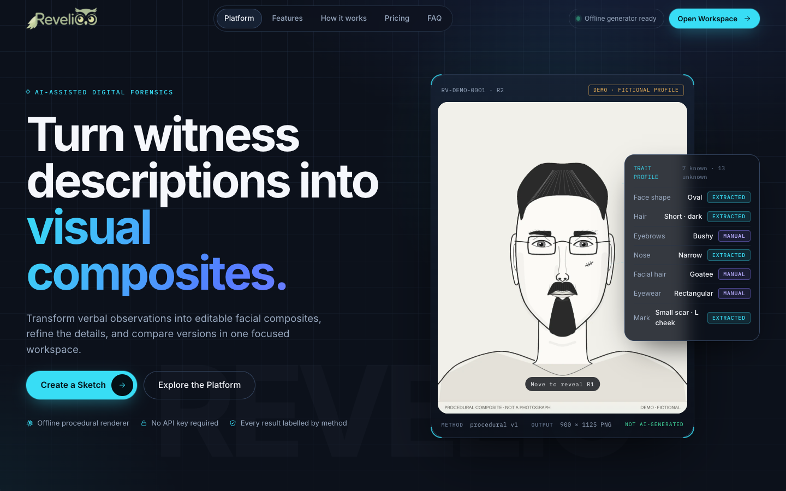

---

## The problem

Building a facial composite from a verbal description is slow. Witnesses remember features unevenly, contradict themselves, and hedge. Separate accounts from different witnesses rarely agree. Most tools either demand a complete description or fill in the gaps silently with invented detail.

## What Revelio does

| | |
|---|---|
| **Description → structured profile** | Deterministic, local extraction of about 20 facial traits plus distinctive marks. Unmentioned traits stay **unknown**. Contradictions are flagged and left **unresolved**. Hedged statements (“maybe”, “I think”) are marked **uncertain**. “I don’t remember his eyes” is recorded as an explicit unknown. |
| **Real offline composite renderer** | A procedural vector renderer draws the face from the profile: face shape, jaw, chin, hairline, hair, brows, eyes, nose, mouth, ears, facial hair, eyewear, age lines and marks. It uses no network, no GPU and no model download. It outputs SVG for live preview and PNG for export, both from the same geometry. |
| **Honest renderer report** | Every result lists which traits were drawn with a neutral default, which are recorded but not drawable (eye colour and skin tone in a monochrome sketch), and which conflicts are pending. Undescribed hair is drawn as a dashed “unspecified” outline, not an invented hairstyle. |
| **Three ways to describe** | A free-text **Description** tab, a **Guided** tab that asks about every trait in turn, and a **Witnesses** tab for separate accounts. Extract with the button or <kbd>⌘/Ctrl</kbd> + <kbd>Enter</kbd>. |
| **Voice dictation** | A *Dictate* button on the description, observations, witness and refinement fields uses the browser's built-in speech recognition. It appends to the text you already have and never submits anything on its own. Works in Chrome, Edge and Safari. Browsers without speech recognition, such as Firefox, don't show the button. Brave and embedded browser views do show it, but there it explains why dictation can't run there, without trying and failing silently. |
| **Interactive editor** | Trait editor with provenance badges (*Described / Extracted / Manual / Unknown / Conflict / Uncertain*). Sixteen proportion sliders, mark placement, live re-rendering, undo/redo (<kbd>⌘/Ctrl</kbd> + <kbd>Z</kbd>) and reset. A pipeline bar across the top shows the real state of each step: description, trait profile, operator review, composite and revision. |
| **Natural-language refinement** | Commands like “Make the eyebrows thicker”, “Add a small scar on the left cheek” or “Make the jaw narrower” are parsed locally. You review and edit the proposed changes before anything is applied. Requests that are no-ops are reported as such, never faked. |
| **Investigation workspace** | The overview shows saved sketches, drafts in progress, revisions recorded and the last-used generation mode, plus recent sketches, unfinished work, recent activity and provider status. The library supports search by title, sketch ID or description, and you can switch a sketch between draft and final. |
| **Revisions & comparison** | Every save is an immutable revision in SQLite. Compare any two revisions with a drag-to-reveal slider or side by side, alongside a trait-by-trait diff. There are no similarity scores or identity probabilities. |
| **Multi-witness merge** | Compare 2–4 independent accounts. Traits are classified as shared, conflicting, single-source or unmentioned. The operator must resolve every conflict before the combined profile can be applied. |
| **Exports** | PNG, JSON (confirmed traits, unknown traits, conflicts, revision history) and a printable HTML report (print to PDF) with the required disclaimer. |
| **Local accounts** | Register with your name, email and password at `/register`, and log in at `/login`. You need an account to use the workspace and saved sketches. Accounts live in the local database only. See [Accounts](#accounts). |
| **Light and dark themes** | A theme toggle in the workspace top bar and the landing-page nav. Dark uses charcoal with coral accents, and light uses cream with green accents. The choice is remembered in this browser. |
| **Optional AI providers** | A replaceable provider interface. Hosted Gemini is **off by default** and configured on the backend only. A local diffusion model is detected and documented, but not shipped (see below). AI output is always labelled AI-generated, and failures never fall back silently. |

### Screenshots

| Workspace overview (`/app`) | New sketch editor (`/app#/new`) |
|---|---|
| 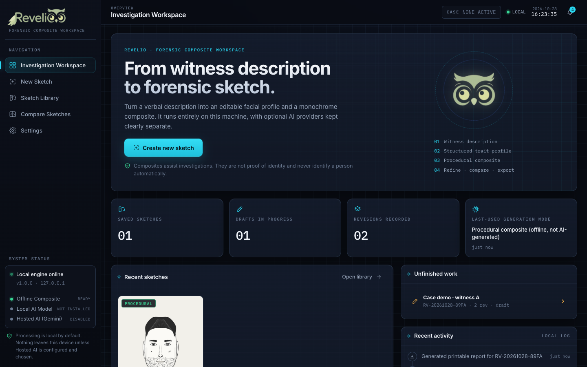 | 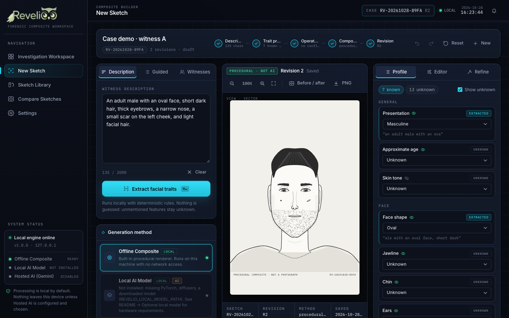 |
| **Light theme · workspace** | **Light theme · editor** |
| 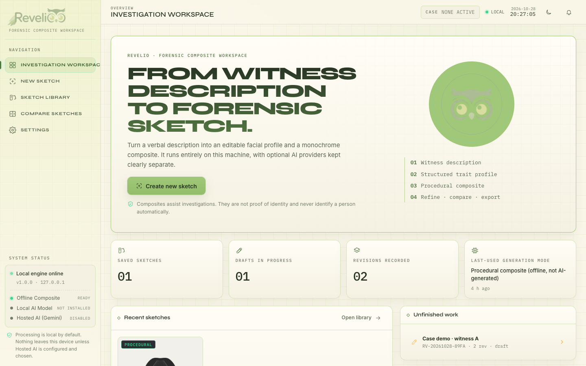 | 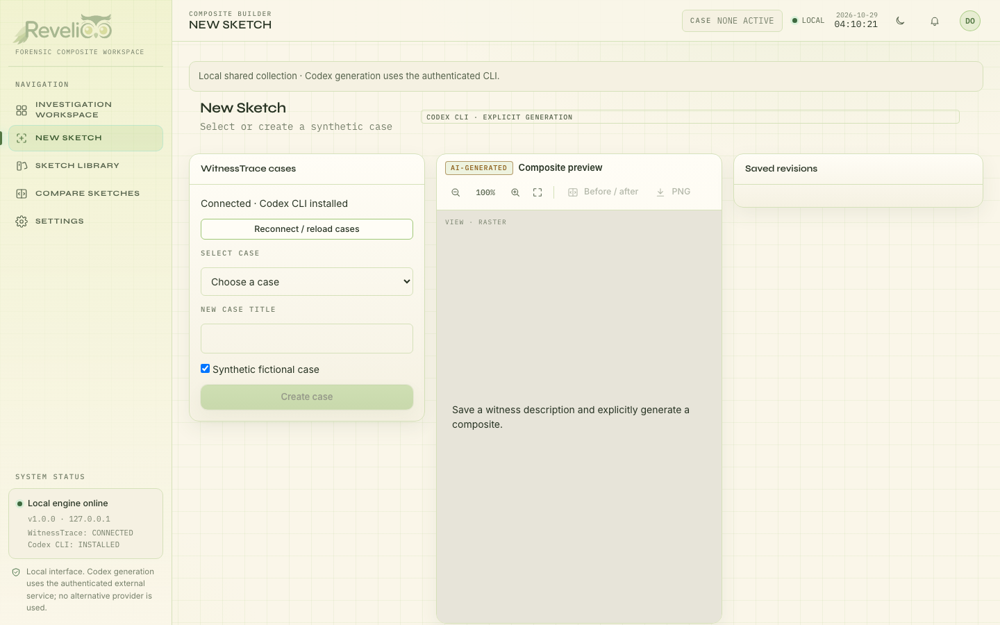 |
| **Landing · live demo** | **Landing · editor showcase** |
| 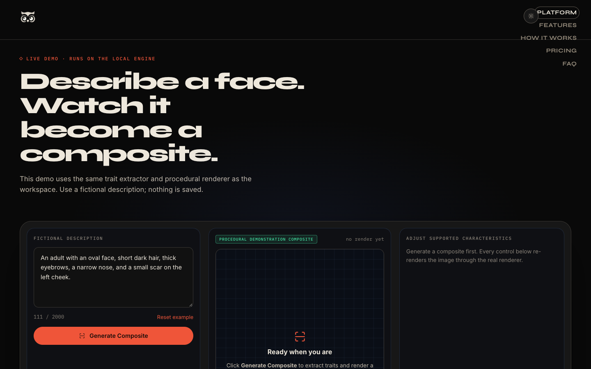 | 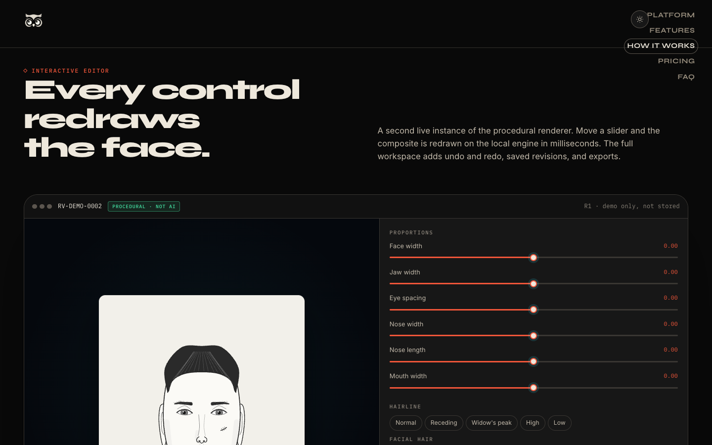 |
| **Compare revisions** | **Library** |
| 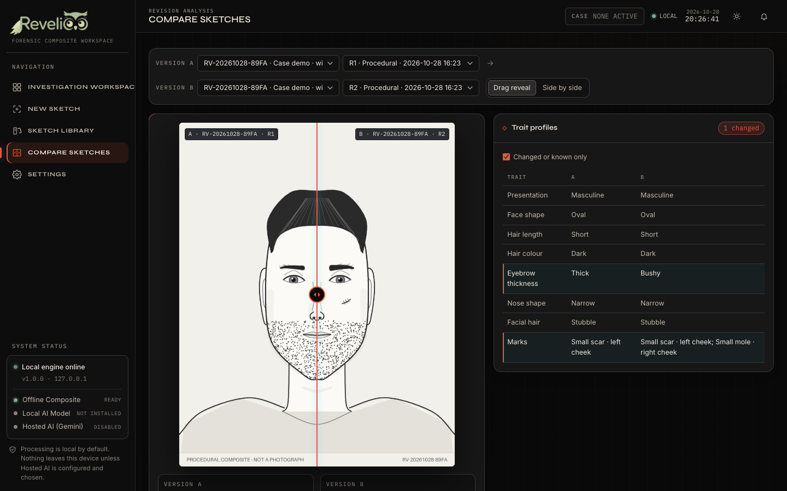 | 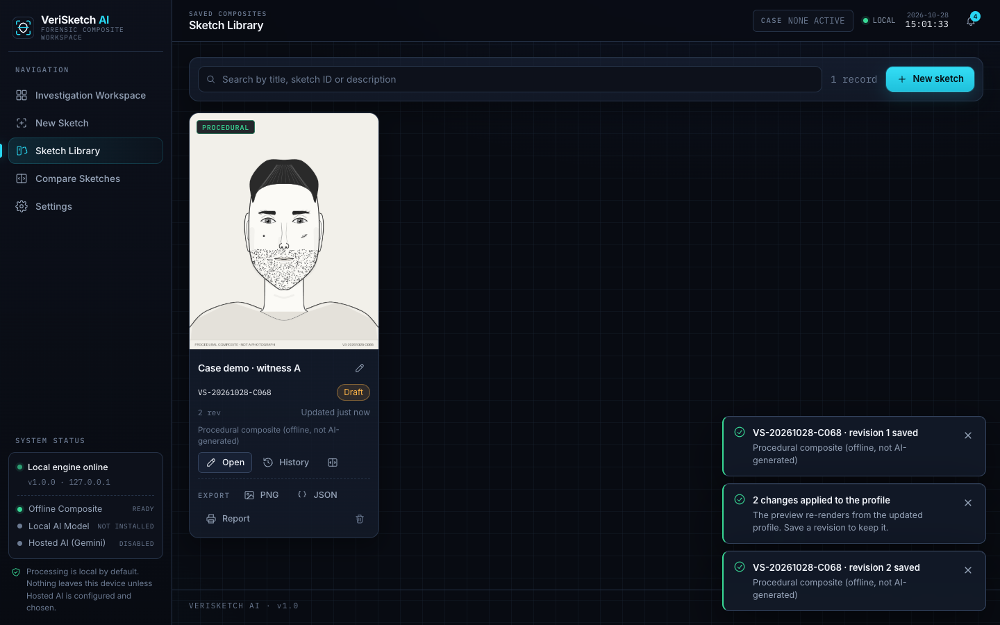 |
| **Settings & providers** | **Landing · light theme** |
| 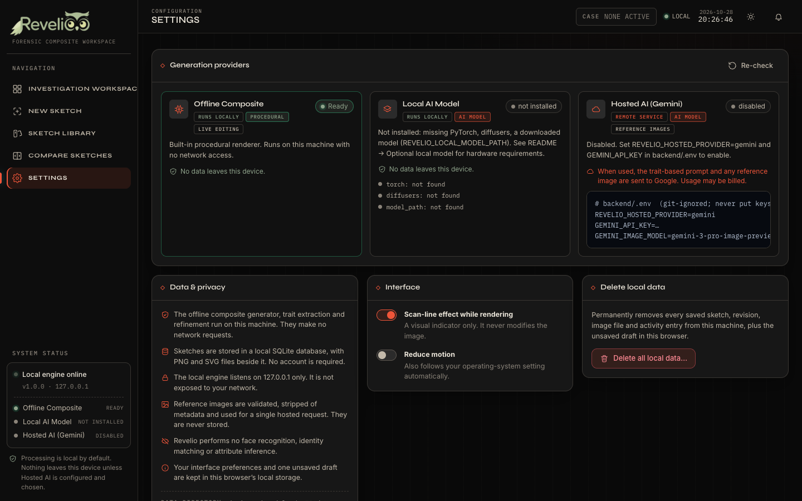 | 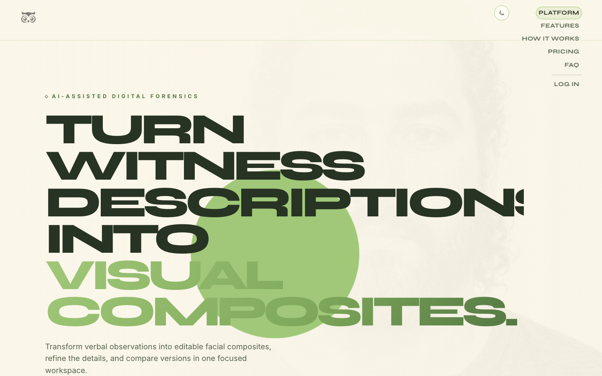 |

Procedural composites generated from eight different descriptions. The bottom-left one has no hair description, so its hair is drawn as “unspecified”:

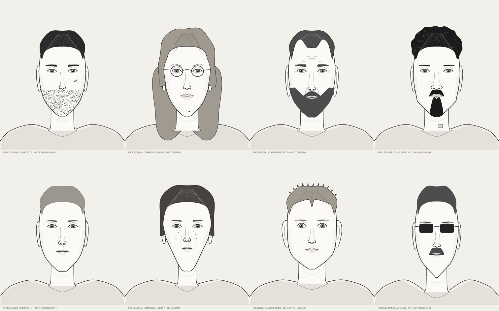

---

## Architecture

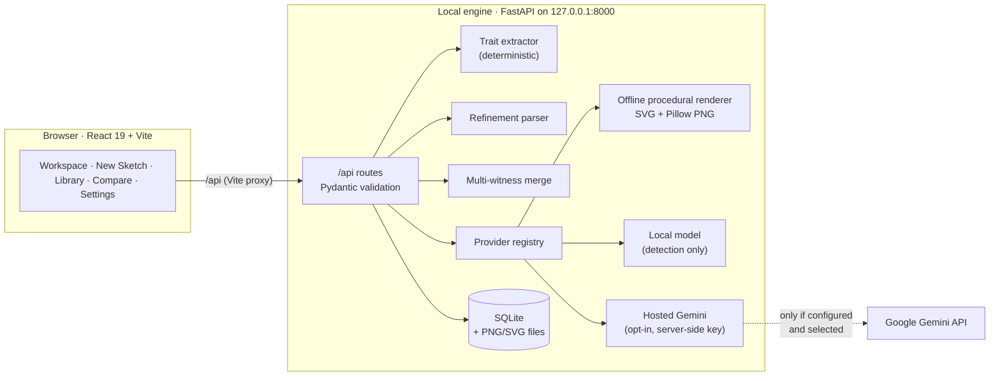

```
backend/
  app/
    main.py              FastAPI app, CORS, error mapping (no secrets in errors)
    config.py            Environment-based settings (+ backend/.env loader)
    catalog.py           Trait catalog — single source of truth for options & renderability
    schemas.py           Pydantic models and validation
    database.py          SQLite (stdlib) schema and helpers
    api/                 auth.py · system.py · traits.py · sketches.py
    services/            auth_service · trait_extractor · procedural_renderer · refinement_service
                         merge_service · sketch_service · report · uploads
    providers/           base · offline_provider · local_provider · hosted_provider · registry
  tests/                 76 pytest tests
src/
  main.jsx             Route switch: / → landing page, /app → workspace (separate lazy bundles)
  auth/                  Login and registration pages
  landing/             Landing page (Lumora-inspired); reuses the API client, renderer and CompareSlider
  api/client.js          API client (no credentials ever pass through the browser)
  state/AppContext.jsx   Catalog, engine status, toasts, preferences, active case
  components/            brand · shell (sidebar, top bar, boot screen) · sketch (viewer, editor,
                         refine, merge, pipeline…) · ui (dictation, theme toggle, modals…)
  lib/                   router · nav · format · theme
  pages/                 Workspace · NewSketch · Library · Compare · Settings
public/landing/          Pre-rendered hero composites (from scripts/render-landing-assets.py)
scripts/                 run-api.mjs · dev-all.mjs · render-landing-assets.py
```

**Technology:** React 19, Vite 8, plain CSS design system with dark and light themes (Syne for display type, Inter for text, IBM Plex Mono for data), FastAPI, Pydantic 2, SQLite, Pillow and pytest. The frontend adds no new dependencies. Animations are CSS keyframes, with `requestAnimationFrame` only where needed, and they respect `prefers-reduced-motion`.

---

## Getting started

Requirements: **Node 20+** and **Python 3.11+**.

```bash
# 1. Frontend dependencies
npm install

# 2. Backend virtual environment (about 60 MB, one time)
python3 -m venv backend/.venv
backend/.venv/bin/pip install -r backend/requirements.txt      # Windows: backend\.venv\Scripts\pip

# 3. Run the API and the interface together
npm run dev         # starts the API and the interface together
```

Open **http://127.0.0.1:5173** for the landing page, or **http://127.0.0.1:5173/register** to create an account and open the workspace. The workspace boot screen checks the local engine. If the engine isn't running, you'll see instructions instead of a broken UI.

| Route | What it is |
|---|---|
| `/` | Marketing landing page with a live demo running on the real procedural renderer (no account needed) |
| `/register` · `/login` | Create a local account or log in |
| `/app` | The Revelio workspace (`/app#/new`, `/app#/library`, `/app#/compare`, `/app#/settings`). Redirects to `/login` when you're not logged in, then returns you to the page you asked for. |

Old links such as `/#/library` redirect to `/app#/library`. For static hosting, serve `index.html` for `/app` as an SPA fallback. Vite's dev and preview servers already do this.

Run the pieces separately if you prefer:

```bash
npm run dev:api     # FastAPI on http://127.0.0.1:8000 (docs at /docs)
npm run dev:web     # Vite only, on http://127.0.0.1:5173 (proxies /api to the engine)
```

### Quality checks

```bash
npm run lint        # ESLint
npm run build       # production build
npm run test:api    # backend pytest suite (76 tests)
```

### Offline use

After installation, the whole core workflow runs with **no network access**: extraction, refinement, merge, rendering, saving, comparison and export. A test (`test_offline_workflow_without_network`) blocks all sockets and runs the workflow. Without internet, the interface falls back from the Google-hosted fonts to system fonts.

Voice dictation is the exception. It relies on the browser's speech service, and depending on the browser, that service may process audio on a remote server. Typing always works offline.

---

### Landing page

The landing page at `/` opens with a short intro (skip it with <kbd>Esc</kbd> or <kbd>Enter</kbd>; it plays once per browser session and never with reduced motion). It then runs through the hero, a live demo, the editor showcase, features, how it works, privacy and capabilities, pricing and an FAQ. The nav has the same light/dark toggle as the workspace. Its demos are real:

- **Live demo:** a visitor types a fictional description, and the page calls the local engine to extract traits and render a procedural composite. Visitors can change traits and sliders, regenerate, and download the PNG.
- **Editor showcase:** a second live renderer instance with real sliders, in-page demo revisions and a before/after slider.
- **Hero imagery:** pre-rendered by the same renderer from a fictional profile. Regenerate it with `backend/.venv/bin/python scripts/render-landing-assets.py`.
- **Pricing:** Pro and Team are labelled as proposals. Their buttons open a notice that collects no data, and only implemented features get a checkmark.

If the local engine isn't running, the demos say so and offer a retry. They never fall back to a static image.

## Accounts

Revelio has simple **local** accounts. They protect the workspace on a shared computer. They are not cloud sign-in.

- **What you need to register:** your full name, an email address and a password of 8–128 characters. The email is only a login name. Revelio never sends email, so there is no verification email and no password reset.
- **Storage:** accounts are stored in `revelio.db` next to your sketches. Passwords are stored as salted **scrypt** hashes, using Python's standard library with no new dependencies, and are never logged or returned by the API.
- **Sessions:** logging in sets an `HttpOnly`, `SameSite=Strict` cookie that lasts 7 days. The database stores only a SHA-256 hash of the session token. Logging out deletes the session and clears the unsaved draft in that browser.
- **Failed logins:** a wrong email and a wrong password give the same message, so the login page doesn't reveal which emails are registered. After 5 failed attempts, that email is locked out for 60 seconds.
- **What needs a login:** everything that reads or changes saved data: sketches, revisions, images, exports, reports, stats, activity, storage info and *delete all*. The landing page's demos stay public because they store nothing: health, catalog, trait extraction, refinement, merge and live rendering.
- **Shared library:** all accounts on one machine share **one sketch library**. Accounts control who can open the workspace. They don't keep each person's cases separate.

## Generation modes

| Mode | Default | Runs | Cost | Status in this build |
|---|---|---|---|---|
| **Offline Composite** | ✅ on | This machine | Free | Fully implemented and tested |
| **Local AI Model** | off | This machine | Free (hardware) | Detection and documentation only |
| **Hosted AI (Gemini)** | off | Google | **May be billed** | Implemented; tested against a mocked API, **not against a real key** |

Every result shows its method next to the image (*Procedural · not AI* or *AI-generated*). The method is also stored with each revision and printed in reports.

### Optional hosted AI (Gemini)

The key lives **only** on the backend. It is sent in the `x-goog-api-key` header, never in the URL, and it is redacted from any error text.

```bash
cp backend/.env.example backend/.env
# then edit backend/.env:
REVELIO_HOSTED_PROVIDER=gemini
GEMINI_API_KEY=your-key-here
GEMINI_IMAGE_MODEL=gemini-3-pro-image-preview
```

Restart the API. The provider then shows as *configured*. It is not verified until a generation succeeds. Revelio makes no claim that this service is free, so check your own quota and pricing. When used, the prompt is built only from **described** traits, with unknown traits explicitly marked unspecified. An optional reference image is sent with that one request. If the provider fails, you see the real error and a one-click option to save an offline composite instead. Nothing switches over silently.

### Optional local model

A local diffusion model (for example Stable Diffusion 1.5) needs roughly **8 GB of free RAM or unified memory** and **5–10 GB of disk**. That is more than a typical student laptop can spare while running a browser and dev servers, and inference couldn't be tested reliably here. So this build ships **detection only**: Settings reports whether PyTorch, `diffusers` and a model path (`REVELIO_LOCAL_MODEL_PATH`) are present. The provider interface (`backend/app/providers/base.py`) is the place to add it.

---

## Security & privacy

- **Local by default.** The engine binds to `127.0.0.1` and CORS allows only the local dev origins. Offline features make no network requests.
- **No secrets in the frontend.** Provider credentials come from backend environment variables. `.env` and `backend/.env` are git-ignored, and `.env.example` files contain placeholders only.
- **Validated input.** Pydantic validates description length, trait options, slider ranges and IDs. Sketch IDs are pattern-checked, and image paths are resolved inside the data directory only.
- **Safe uploads.** Reference images are checked for type allow-list, magic bytes, size (5 MB by default), dimensions and decompression bombs. They are then re-encoded, which strips EXIF and GPS metadata, used for one hosted request, and **never stored**.
- **No biometric processing.** There is no face detection, recognition, identity matching or sensitive-attribute inference.
- **Local accounts.** You must log in to see saved sketches and exports. Passwords are hashed with scrypt, and session cookies can't be read by page scripts. See [Accounts](#accounts).
- **Deletion.** Delete a single sketch with all its revisions and image files from the Library, or wipe all local data from Settings (type `DELETE` to confirm).
- **Data location.** `backend/data/` holds `revelio.db` and `images/` (override with `REVELIO_DATA_DIR`).
- **Browser storage.** The browser keeps only interface preferences, the theme choice and one unsaved draft (`revelio.*` keys in local storage).
- **Dictation.** Speech recognition is provided by the browser, not by Revelio. Revelio never records or stores audio, but the browser's speech service may send audio off the device.

These are engineering safeguards for a local demo. They are not a claim of legal compliance or enterprise-grade security.

### Upgrading from VeriSketch AI

The project was previously called VeriSketch AI. Existing installs keep working:

- `VERISKETCH_*` environment variables are still read when the matching `REVELIO_*` variable isn't set.
- An existing `backend/data/verisketch.db` is renamed to `revelio.db` the first time the engine starts.
- Old `VS-…` sketch IDs stay valid. New sketches get `RV-…` IDs.
- Saved browser drafts and preferences are carried over automatically.

## Known limitations

- The procedural renderer is stylised and monochrome. It draws a front-facing composite, not a photorealistic likeness. Eye colour and skin tone are recorded but not drawn.
- Trait extraction is rule-based English. Unusual phrasing may be missed, but missed traits stay **unknown** rather than becoming wrong. The guided questions cover every trait.
- Real hosted generation has not been verified with a working API key.
- Local-only: accounts share one sketch library, and there are no roles, no password reset, no sync and no audit-grade chain of custody.
- Voice dictation depends on browser support. It is unavailable in Firefox, Brave and embedded browser views.

## Future improvements

- Optional local diffusion provider with img2img conditioning from the procedural sketch.
- More feature variants (hair textures, headwear, three-quarter view).
- Multilingual extraction and witness-interview scripts.
- Signed, tamper-evident export bundles with a full audit log.

---

Built for HackFest 2026 by team SSDNexus (T1-20).
